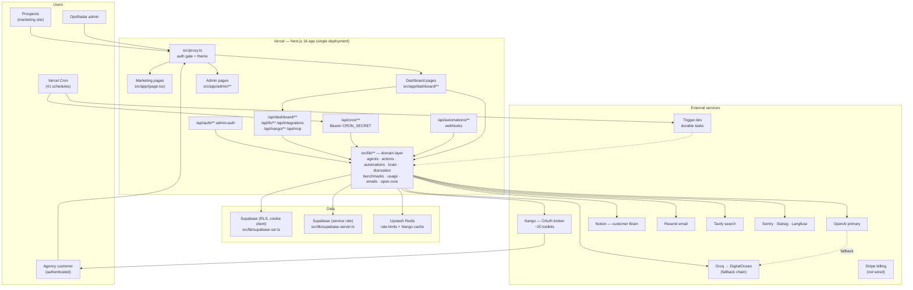
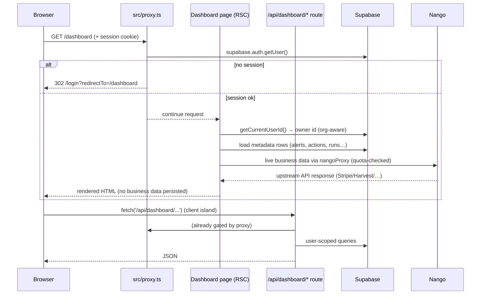
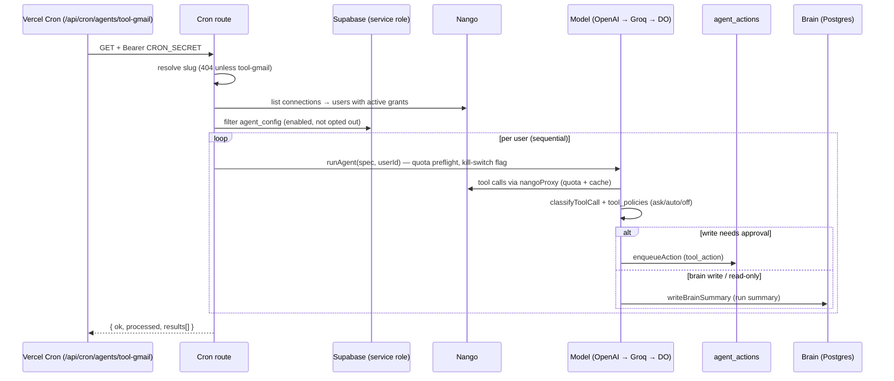
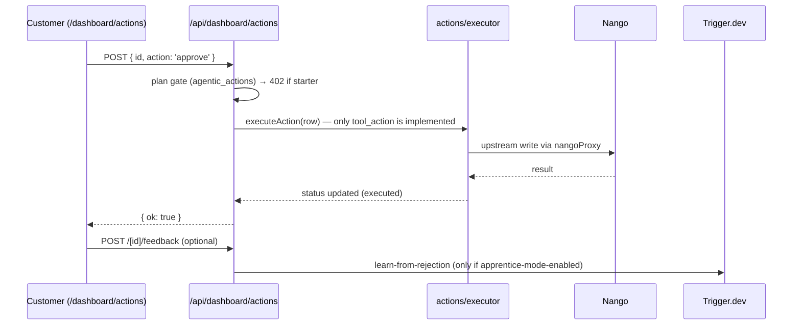
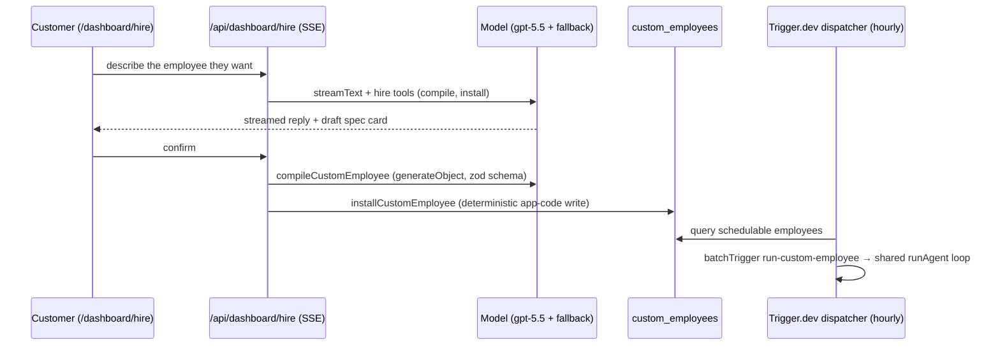

# OpsRadar — Project Architecture

> **Status of this document.** Written 2026-10-18 as a read-only investigation of the working tree at commit `cbdddef` ("Fresh start", 2026-09-05). Nothing in the repository was modified to produce it. Where a claim is an inference rather than a fact visible in the code or docs, it is explicitly labelled **inference** or **uncertain**. File paths and symbols were verified by reading the files named.
>
> **Audience.** A developer joining the project with no prior exposure to it.

---

## 1. Project Overview

OpsRadar is a web application with two (currently) coexisting identities:

1. **A hosted AI "operations intelligence" SaaS** for client-service businesses (agencies, consultancies, dev studios, recruiters, accounting practices). Customers connect their business tools (Stripe, HubSpot, ClickUp, Harvest, Gmail, Notion, …), and a stack of scheduled + conversational AI "employees" surfaces revenue, delivery, profitability, and scope risks — with a human approval gate between AI proposals and real-world writes.
2. **An open-source "open core"** (`src/lib/open-core/`) being extracted from that SaaS: dependency-free TypeScript that evaluates a portable dataset of clients, projects, time entries, and invoices with four transparent, evidence-backed rules (overdue receivables, unbilled work, budget burn, low delivery margin).

The repository is explicitly in a **transition**: the README describes it as "a private transition branch" whose reusable open core "is ready for contribution, but the repository still contains historical startup material that must be removed and scrubbed from Git history before the repository is made public" (`README.md`, `docs/OPEN_SOURCE.md` — "Public-release gate").

The single-sentence problem statement (from `docs/OPEN_SOURCE.md`):

> Where are we losing cash, capacity, or margin before the problem reaches month-end?

A core product rule recurs throughout the codebase and docs: **AI may explain a finding or draft a next step, but it is never the sole basis for a risk.** The open-core rules are deterministic and every alert carries its evidence.

For the hosted product, the architectural rules that matter most (all documented in `CLAUDE.md` and enforced by code structure):

- **Customer business data is not persisted in OpsRadar's database.** Dashboard data is live-fetched through an OAuth broker; only computed metadata (actions, briefings, run history, settings) is stored in Supabase. Declared a "hard architectural rule" in `CLAUDE.md` (§ No Client Data Persistence).
- **AI never writes to customers' tools without an approval gate.** Every write proposal goes through an Ask/Auto/Off policy engine and lands in a queue (`/dashboard/actions`) unless explicitly auto-approved.
- **OAuth tokens never live in OpsRadar.** They are held by the integration broker (Nango). The database holds the user↔connection mapping "resolved live from Nango" (`docs/adr/0010-nango-broker.md`).

---

## 2. Executive Summary

The fastest orientation available:

- **What it is:** a Next.js 16 (App Router, React 19, Tailwind v4) full-stack application deployed on Vercel, with Supabase for auth/Postgres, Nango as the OAuth/tool broker, OpenAI (with Groq + DigitalOcean fallbacks) as the model provider, Notion as the customer-owned "Brain" (knowledge store), Trigger.dev for durable scheduled jobs, Upstash Redis for rate limiting/caching, and Sentry/Statsig/Langfuse for observability. ~53k lines of TypeScript across 368 files, 78 API route handlers, 44 pages, 40 SQL migrations.
- **Two front doors:** the marketing site (`/`, `/product`, `/pricing`, `/for/*`, …) and the customer dashboard (`/dashboard/*` — a single "Hire" chat surface plus queues, runs, brain, integrations, settings). Plus a password-protected `/admin` panel.
- **Two generations of architecture are visible at once.** The codebase has been through at least three large pivots (documented in `CLAUDE.md` as "CP-NN" change points and in twelve ADRs): (a) retirement of the original operations-audit funnel and its RAG knowledge base; (b) wholesale replacement of the Composio integration broker with Nango after Composio's May 2026 security breach, which also tore down a 28-agent stack (partially rebuilt); (c) collapse of three separate AI surfaces into one `/dashboard/hire` chat. **Older docs (`CLAUDE.md`, `docs/specs/*`, `AGENTS.md`) describe pre-pivot states and are partly stale** — this document flags specific staleness where relevant.
- **The newest direction** is the open core in `src/lib/open-core/` (4 files, ~530 lines including tests), which is dependency-free and covered by the only automated tests in the repository (`npm run test:open-core`, Node's built-in test runner via `tsx`).
- **Biggest current risks to understand before touching anything:** a single-line removal of a stale `AGENTS.md`-described audit pipeline is already done; the bigger live concerns are repo-hygiene for the public release (submodule pointers without `.gitmodules`, historical material still in Git history), the mid-rebuild agent system, and several documented-but-unverified security postures (admin gating returns 404; fail-closed vs fail-open rate limits; PII sent to Sentry).

---

## 3. Technology Stack

All versions below are pinned in `package.json` and cross-checked against `docs/dev/stack-reference.md` (an exceptionally detailed, maintainer-written guide to version-specific APIs; dated 2026-05-27). The stack deliberately sits at the bleeding edge of mid-2026; the stack-reference exists because "a coding agent's default knowledge is *stale* for these — it will confidently emit APIs that were renamed, removed, or inverted."

### 3.1 Languages and frameworks (confirmed, actively used)

| Technology | Version | Role | Where configured / used |
|---|---|---|---|
| TypeScript | ^5 | Entire codebase; `strict: true` | `tsconfig.json` |
| Next.js | ^16.2.2 (App Router only) | Full-stack framework: pages, layouts, API route handlers, metadata routes, redirects, headers/CSP, cron manifest | `next.config.ts`, `src/app/**` |
| React | 19.2.4 (pinned exact) | UI runtime; Server Components by default | `src/app/**`, `src/components/**` |
| Node.js runtime | `nodejs` runtime on all examined routes; `@types/node` ^20 | Server runtime for route handlers | `export const runtime = 'nodejs'` in routes |
| Tailwind CSS | v4 | CSS-first styling; **no `tailwind.config.js`** — design tokens live in `@theme {}` inside `src/app/globals.css` | `postcss.config.mjs`, `src/app/globals.css` |

### 3.2 Backend / data / auth

| Technology | Version | Role | Where used |
|---|---|---|---|
| Supabase (`@supabase/supabase-js`, `@supabase/ssr`) | 2.100.1 / 0.10.3 | PostgreSQL database, auth (session cookies), SSR client | `src/lib/supabase-server.ts` (service-role), `src/lib/supabase-ssr.ts` (cookie-aware, RLS-scoped), `src/proxy.ts`, `supabase/migrations/*.sql` |
| Upstash Redis (`@upstash/redis`, `@upstash/ratelimit`) | 1.37.0 / 2.0.8 | Rate limiting + Nango connection-id L2 cache | `src/lib/rate-limit.ts`, `src/lib/nango.ts` |
| Nango (`@nangohq/node`, `@nangohq/frontend`) | 0.70.4 | OAuth broker + API proxy to ~20 customer toolkits. **Replaced Composio on 2026-05-26** | `src/lib/nango.ts`, `src/app/api/nango/*`, `src/lib/nango/tools/*` |
| Trigger.dev (`@trigger.dev/sdk`, `/build`, `/react-hooks`) | 4.4.6 | Durable background jobs (custom-employee dispatcher, automation execution, learning jobs) | `trigger.config.ts`, `src/trigger/*.ts` |
| Vercel | — | Hosting + Cron + Analytics + Speed Insights | `vercel.json` (41 cron entries), `@vercel/analytics`, `@vercel/speed-insights` |

### 3.3 AI / agent layer

| Technology | Version | Role | Where used |
|---|---|---|---|
| Vercel AI SDK (`ai`) | ^6.0.191 | Model calls: `generateText`, `generateObject`, `streamText`, tool calling, step control | `src/lib/agents/loop.ts`, `src/lib/ai/model-provider.ts`, `src/lib/hire/ai-sdk-tools.ts`, `src/lib/coo/*` |
| `@ai-sdk/openai` | ^3.0.65 | OpenAI provider; also used with custom `baseURL` for Groq and DigitalOcean (`.chat()` path) | `src/lib/ai/model-provider.ts` |
| OpenAI | `^6.33.0` SDK installed; AI traffic goes through the AI SDK wrapper (direct SDK use flagged as a smell in `docs/dev/stack-reference.md`) | Model provider (gpt-5.x family; `gpt-4o` in older docs) | `src/lib/openai.ts` |
| Groq / DigitalOcean Gradient | — | Fallback model providers (capability-aware routing; see ADR 0012) | `src/lib/ai/model-provider.ts` |
| Langfuse (`langfuse`) | 3.38.20 (legacy pre-OTel SDK, intentional) | Agent/LLM tracing | `src/lib/observability/langfuse.ts` |
| Vercel Flags (`flags`) + Statsig (`@statsig/statsig-node-core` + client plugins) | 4.0.6 / 0.19.3 | Kill-switch flags backed by Statsig gates; client analytics + session replay | `src/lib/flags/index.ts`, `src/components/analytics/statsig-provider.tsx` |
| Tavily | — (API service) | Intended web-search tools; **now a stub** — `src/lib/coo/research.ts` returns empty payloads | §11.3 |

### 3.4 Integrations and external services

| Technology | Role | Notes |
|---|---|---|
| Notion (`@notionhq/client` ^5.22.0) | The customer-owned "Brain": ~20 databases + pages per customer, created programmatically | `src/lib/notion/*`, `src/lib/brain/*`. SDK v5 "data sources" model (see stack-reference) |
| Resend (`resend` ^6.9.4) | Transactional email (export notifications, alerts) | `src/lib/emails/*`, `src/lib/notion/email-brain-ready.ts` |
| Stripe (`stripe` ^22.1.1) | OpsRadar's own SaaS billing (customer Stripe data flows through Nango, not this SDK) | No live billing routes found in the API tree (see §11.3) |
| HubSpot client (`@hubspot/api-client` ^13.5.0) | Type/transitive dependency; live HubSpot data goes through Nango | See stack-reference |
| Sentry (`@sentry/nextjs` ^10.53.1) | Error tracking + cron monitors + Replay | `src/instrumentation.ts`, `src/instrumentation-client.ts`, `sentry.server.config.ts`, `sentry.edge.config.ts` |

### 3.5 UI layer

| Technology | Role | Notes |
|---|---|---|
| `radix-ui` ^1.4.3 (unified package) + `shadcn` ^4.1.2 | UI primitives copied into `src/components/ui/` | `components.json` (style `radix-vega`, RSC true) |
| `framer-motion` ^12.38.0 | **Installed but not used in any live page** — the only import is the orphaned `src/components/WorkflowDiagram.tsx` (see §19 item 16); marketing motion is DOM/CSS-based (`RevealOnScroll`) | `package.json` |
| `lucide-react` ^1.8 | Icons | Throughout |
| `sonner` | Toasts | `src/components/ui/toast.tsx` |
| `react-markdown` + `remark-gfm` | Rendering markdown (chat/brain) | `src/components/dashboard/markdown-content.tsx` |
| `jszip` ^3.10.1 | Zip archives for Brain export/download | `src/app/api/dashboard/brain/download/route.ts`, `src/app/api/cron/brain-export/route.ts` |
| `clsx` + `tailwind-merge` + `class-variance-authority` | className composition (`cn()` in `src/lib/utils.ts`) and variant props for the UI primitives | `src/components/ui/{button,badge}.tsx` etc. |

### 3.6 Tooling (dev-only)

| Technology | Role | Notes |
|---|---|---|
| ESLint 9 flat config + `eslint-config-next` 16.2.1 | Linting (`npm run lint` = bare `eslint`) | `eslint.config.mjs` |
| `tsx` 4.23.12 | Runs the open-core test file directly | `npm run test:open-core` |
| Playwright ^1.59.1 | Installed but **no test scripts or test files found** — appears unused for now | `package.json` |
| `@trigger.dev/build` | Build-time support for Trigger.dev tasks | `trigger.config.ts` |

### 3.7 Installed but of unclear/latent use (evidence-based)

- **`tailwind` (meta package, ^4.0.0)** — the real engine is the `tailwindcss` devDependency + `@tailwindcss/postcss`; the plain `tailwind` dependency is described as a "meta/no-op-ish" package in the stack-reference.
- **`@anthropic-ai/sdk`** — installed; quota plumbing anticipates Claude (`inferLlmProvider` routes `claude*` slugs) but "Claude models are not yet wired into the loop" (stack-reference).
- **`@hubspot/api-client`** — not the live data path (Nango is).
- **`stripe`** — for OpsRadar's own SaaS billing; no billing integration was found wired in the API routes (STRIPE_SECRET_KEY is even absent from `.env.example`). Treat billing as **not implemented in this tree** despite the dependency and the pricing page.
- **`@vercel/analytics`** — `<Analytics />` is mounted in the root layout. **`@vercel/speed-insights` is installed and CSP-allowlisted (`vitals.vercel-insights.com`) but not initialized anywhere in `src/`** — it may be injected at the Vercel platform layer, but from the repo alone it is unused (frontend investigation, high confidence).
- **`openai` (SDK)** — installed; direct SDK use is discouraged in favor of the AI SDK wrapper.
- **`cheerio`, `pdf-parse`, `html2pdf.js`, `culori`, `chart.js`** — installed but **no imports exist anywhere in `src/`** (verified by grep). They are leftovers from the scraping/export/design eras; `chart.js` is doubly interesting because `CHART_COLORS` in `src/app/dashboard/_lib/theme.ts` was written for it but also has no consumers.

### 3.8 Notable version traps (from `docs/dev/stack-reference.md`, verified pattern-level)

A new developer **will** get these wrong from muscle memory. The stack-reference lists the full deltas; the highest-impact ones:

- Next 16: `params`/`searchParams`/`cookies()`/`headers()` are async; `fetch` and route `GET` are uncached by default; `middleware.ts` was renamed to **`proxy.ts`** (this repo has `src/proxy.ts`); Turbopack is the default bundler — this repo opts back into webpack (`next dev --webpack`).
- React 19: `ref` is a plain prop (`forwardRef` deprecated); form actions/`useActionState`.
- Tailwind v4: CSS-first `@theme {}`, no config file.
- AI SDK v6: `tool({ inputSchema })` (not `parameters`); `stopWhen: stepCountIs(n)` (not `maxSteps`); stream parts use `.text` / `.input` / `.output`.
- `@supabase/ssr`: cookie adapter must be `getAll`/`setAll` (get/set/remove removed; the client throws otherwise).
- Notion SDK v5: `dataSources.query` (not `databases.query`).
- Trigger.dev v4: import from `@trigger.dev/sdk` (the `/v3` subpath is deprecated).
- Langfuse: this repo is intentionally on 3.x (`flushAsync()`, explicit `client.trace()`); the OTel pattern is v4-only.
- Radix: unified `radix-ui` package (no `@radix-ui/react-*` imports).

---

## 4. How the Project Was Created

### 4.1 What the evidence shows

- The repository contains a Next.js App Router project scaffolded with modern tooling (`create-next-app` conventions are clearly present: `eslint.config.mjs` flat config, `postcss.config.mjs`, `next.config.ts`, `app/` directory, `next-env.d.ts`). **Inference (high confidence):** created from `create-next-app` in early-to-mid 2026, then heavily extended; the framework boilerplate has been almost entirely replaced.
- **Git history is intentionally gone.** `git log` shows exactly one commit — `cbdddef` "Fresh start", authored 2026-09-05 — and no remotes. The real development history (all those CP-NN change points referenced in docs) was squashed before this working tree. The docs say why: `OPEN_SOURCE.md` requires scrubbing historical startup material from Git history before the repo goes public.
- **The implementation timeline is recoverable from dated artifacts, not Git:**
  - `supabase/migrations/` spans `20260411_*` → `20260526_*` (46 days).
  - `docs/dev/plans/` and `docs/dev/specs/` are dated 2026-05-19 → 2026-05-25.
  - ADRs are dated May 2026; ADR 0010/0011/0012 are dated 2026-05-27 and describe the final visible pivots.
  - `CLAUDE.md` narrates change points CP-14 → CP-23 (May 2026).
  - **Inference (high confidence):** the product was built intensely in ~April–May 2026 by the founder (single author name in the commit), with AI coding agents assisting (many docs are written for agent consumption: `AGENTS.md`, `CLAUDE.md`, `docs/dev/stack-reference.md`, `.claude/skills`, `skills-lock.json`).
- **Bus factor:** the single commit author email and the "Owner: founder" notes in docs suggest, but do not prove, a one-person project. **Uncertain.**

### 4.2 Creation method — facts vs inference

| Question | Answer | Basis |
|---|---|---|
| Scaffolded with a framework CLI? | Almost certainly | Standard Next.js file layout, `components.json` (shadcn CLI), `next-env.d.ts`, ESLint flat config, trademarks of standard generators. **Inference.** |
| Which commands develop/build it? | `npm run dev` / `npm run build` (both with `--webpack`) | `package.json` |
| Was there a monorepo? | No workspace config found; single `package.json`. `tsconfig` excludes a `backend/` dir that no longer exists — evidence a second service once lived beside this repo, matching the documented `chatv2` Hono service severed in CP-15 (`CLAUDE.md`, ADR 0001) | `tsconfig.json`, docs |
| AI-assisted development? | Yes — explicitly documented | Repo-root agent files, "conversion via parallel subagent dispatch" in CLAUDE.md, `.claude/`, `superpowers` submodule, `skills-lock.json` |

### 4.3 Evolution in four chapters (all evidenced)

1. **Audit-funnel era.** Original product: a multi-step questionnaire producing an AI automation audit (`AGENTS.md` still describes it; archived plans reference `/api/generate-audit`, `knowledge-retrieval.ts`, website scraping). Documents, embeddings, and an n8n blueprint engine existed.
2. **CP-14 → CP-23 (May 2026).** Pivot to "AI Chief of Staff for marketing agencies": approval-gated agent writes, AI COO chat, Composio brokerage, Notion Brain, 28 cron agents, customer-built automations, skills-over-RAG migration, quota system.
3. **CP-15/CP-16 (May 2026).** The separate `chatv2` Hono backend and all n8n integration were severed (ADR 0001: "no second backend, no n8n integration, no workflow generator"); the audit funnel and its knowledge-base consumers were retired (CLAUDE.md CP-16).
4. **The 2026-05-26/27 pivot.** Composio breach → replace broker with Nango wholesale (ADR 0010); collapse `/dashboard/coo` + `/dashboard/agents` + `/dashboard/automations` into `/dashboard/hire` (ADR 0011); add the OpenAI→Groq→DigitalOcean model fallback chain (ADR 0012). The agent registry was reduced to a single agent (Gmail) mid-rebuild.
5. **Open-source transition (post-May 2026; this tree).** `README.md`/`docs/OPEN_SOURCE.md`/`CONTRIBUTING.md`/`SECURITY.md` rewritten for open source; `src/lib/open-core/` extracted; historical material deleted from the working tree; history squashed ("Fresh start", 2026-09-05). The `AGENTS.md` file was **not** updated to match — it still describes the dead audit pipeline (see §19).

---

## 5. Repository Structure

```
opsradar/
├── src/
│   ├── app/                     # Next.js App Router (pages + API routes + metadata)
│   │   ├── page.tsx             # marketing homepage
│   │   ├── layout.tsx, globals.css, global-error.tsx
│   │   ├── about|product|pricing|how-it-works|faq|for/*|terms|privacy|audit|waitlist|unsubscribe/
│   │   ├── login|auth/*|forgot-password/          # customer auth pages
│   │   ├── dashboard/           # the product UI (see §9)
│   │   ├── admin/               # password-protected admin panel
│   │   ├── api/                 # 78 route handlers (see §11)
│   │   └── dev/primitives/      # internal design-primitive gallery
│   ├── components/              # shared UI (ui/, marketing/, dashboard/, admin/, analytics/, ...)
│   ├── lib/                     # ALL business logic (see the map below)
│   ├── trigger/                 # Trigger.dev tasks (durable jobs)
│   ├── proxy.ts                 # Next 16 "middleware": auth gate + theme (see §6.3)
│   └── instrumentation*.ts      # Sentry server/edge/client init
├── supabase/migrations/         # 40 SQL migrations, 2026-04-11 → 2026-05-26
├── knowledge-base/              # 351 markdown files: agent skills + legacy KB material
│   └── skills/                  # 47 SKILL.md files across 9 domains (the live skill catalog)
├── docs/
│   ├── OPEN_SOURCE.md           # scope, roadmap, public-release gate
│   ├── adr/                     # 12 architecture decision records
│   ├── specs/                   # design specs (partly pre-pivot)
│   ├── dev/                     # stack-reference (must-read), dated plans, archive
│   ├── copy/, design/, operations/   # marketing copy/authored design refs; founder ops research
├── scripts/                     # embed-kb.ts (legacy embeddings), skill-clusters.ts (KB→skills mapping)
├── public/                      # logos, icons, OG image
├── .env.example                 # the canonical env-var list (see §13)
├── next.config.ts               # CSP, redirects, headers, Sentry wrapper, file tracing
├── vercel.json                  # 41 cron schedules
├── trigger.config.ts            # Trigger.dev project + task dir
├── components.json              # shadcn CLI config
├── eslint.config.mjs, postcss.config.mjs, tsconfig.json
├── AGENTS.md / CLAUDE.md        # AI-agent instruction files (STALE — see §19)
├── README.md / CONTRIBUTING.md / SECURITY.md / LICENSE (Apache-2.0)
└── superpowers/, andrej-karpathy-skills/, design-libraries/ui-skill/   # git submodules (vendored agent tooling, NOT app code)
```

**What is *not* application code** (avoid mistaking for project source):

- `node_modules/`, `.next/`, `tsconfig.tsbuildinfo` — generated.
- `superpowers/`, `andrej-karpathy-skills/`, `design-libraries/ui-skill/` — git submodules (mode `160000`) containing third-party agent-skill collections. Note: **no `.gitmodules` file exists**, so `git submodule update` won't work on a fresh clone — a repo-hygiene issue for the public release.
- `.claude/skills/`, `.agents/product-marketing.md`, `skills-lock.json` — AI-tooling state for coding agents.
- `knowledge-base/_archive/`, the non-skills `knowledge-base/` folders (benchmarks, patterns, failures, tools, playbooks, agency-profiles), `scripts/embed-kb.ts` — legacy knowledge material from the RAG era; the live catalog is `knowledge-base/skills/**/SKILL.md`.
- `docs/operations/payments-iraq-research.md`, `docs/copy/`, `docs/design/` — authorship/business material, not runtime code.

### 5.1 `src/lib/` — the map that matters

Business logic lives almost entirely in `src/lib/` (~120 files). Grouped by role:

| Area | Files | What it owns |
|---|---|---|
| **Open core** | `open-core/{evaluate,types,index}.ts` + test | Portable, dependency-free risk rules (§9.1) |
| **Auth / security** | `supabase-ssr.ts`, `supabase-server.ts`, `security.ts`, `security-server.ts`, `admin-session.ts`, `rate-limit.ts`, `abuse-protection.ts` | Session clients, service-role client, rate limiting, admin cookie signing |
| **Org / tiering** | `org.ts`, `tier.ts`, `funnel.ts` | Effective user resolution (org owner), plan tiers |
| **Integration broker** | `nango.ts`, `nango/{connections,load-tool,registry}.ts`, `nango/tools/*` | Nango client, connection cache, per-tool wrappers |
| **AI agents** | `agents/{loop,registry,types,hooks,load-skill,tier-gate,tool-policies,confidence,employee-metadata}.ts`, `agents/tools/gmail/` | The agent run loop and one wired tool agent |
| **Model providers** | `ai/model-provider.ts`, `openai.ts` | Fallback chain, wrappers |
| **AI employees** | `employees/{compile,install,registry,hierarchy,consult-coo,types}.ts`, `hire/{ai-sdk-tools,system-prompt}.ts` | Custom employee compilation/installation via chat |
| **Chat agent** | `coo/{executor,build-executor-context,outcomes,research}.ts` | Tool dispatch, context building, web research tools |
| **Actions** | `actions/{evaluator,executor,outcome-tracker,approval-patterns,dedup,usage,types}.ts`, `actions/evaluators/*` | The propose→approve→execute→learn cycle |
| **Automations** | `automations/{registry,execute,draft-schema,types}.ts` | Customer-defined "when X do Y" specs |
| **Brain (v2)** | `brain/{store,sync-to-notion,paths,agent-hints,types}.ts`, `notion/*` | Versioned knowledge store + Notion mirror |
| **Diorization** | `diorization/{runner,synthesizer,pattern-detector,living-brief,types}.ts`, adapters/* | Document ingestion → structured signals |
| **Benchmarks / warehouse** | `benchmarks/*`, `warehouse/{events,query,backfill,types}.ts` | Anonymous peer benchmarks; event warehouse |
| **Usage / quota** | `usage/{track,types}.ts` | Per-tenant API quota enforcement (CP-23) |
| **Emails / notifications** | `emails/*`, `notifications/{slack,teams}.ts` | Email bodies; chat notifications |
| **Webhooks** | `webhooks/dispatch.ts` | Outgoing webhook signing/delivery |
| **Flags / observability** | `flags/index.ts`, `observability/langfuse.ts`, `dev-log.ts` | Statsig-backed kill switches; tracing |
| **Misc domain** | `agency-score.ts`, `health-report.ts`, `profitability.ts`, `retainer.ts`, `scope-creep.ts`, `fo.ts`, `fo-audit.ts`, `fo-branding.ts`, `dashboard-alert-rules.ts`, `briefing-types.ts`, `intelligence` helpers | Computed metrics for dashboards |
| **Generated** | `database.types.ts` | **Auto-generated** by `npm run types:supabase` — never hand-edit |

---

## 6. Architecture Overview

### 6.1 The shape (single-system)

Per ADR 0001 (CP-15) and confirmed by the tree: **one Next.js application on Vercel + Supabase. There is no second backend, no n8n, no workflow generator.** Everything runs from this repository. Third-party services are called from route handlers, server components, or Trigger.dev tasks.

Layered view:

1. **Presentation** — `src/app/**` (RSC pages + client islands), `src/components/**`. Marketing site, dashboard, admin.
2. **HTTP boundary** — 78 route handlers under `src/app/api/**`; `src/proxy.ts` gates `/dashboard/*` (pages → redirect to `/login`; APIs → 401 JSON) and `/admin/*` (nonexistent-session → 404), and sets the `x-theme` header.
3. **Domain/application logic** — `src/lib/**` (agents, actions, automations, brain, benchmarks, usage, emails, domain computations). This is where business logic lives; route handlers are thin orchestration over it.
4. **Data access** — two Supabase clients with different trust levels (`supabase-ssr.ts` = user-scoped cookie client; `supabase-server.ts` = service-role client that bypasses RLS), plus Upstash Redis for limiter/caching.
5. **External services** — Nango (customer SaaS data + writes), OpenAI/Groq/DigitalOcean (models), Notion (customer Brain), Resend (email), Tavily (search), Trigger.dev (durable jobs), Sentry/Statsig/Langfuse (observability), Stripe API (billing — not wired), Vercel (hosting/cron).

**Pattern note:** this is a conventional Next.js "server-first" architecture, not a formal pattern like Clean Architecture or hexagonal. The nearest honest label is **modular monolith with a thin HTTP layer and thick `src/lib` domain modules**, with background work split between Vercel Cron routes and Trigger.dev tasks.

### 6.2 How dependencies flow

- `src/app/**` page/route files import from `src/lib/**` and `src/components/**` (alias `<npm>/*` → `./src/*` — an unusual but consistent alias; the codebase deliberately does **not** use `@/`).
- `src/lib/**` modules import each other freely (e.g. `nango.ts` → `usage/track.ts`, `sentry`; `agents/loop.ts` → model-provider, skills, tool-policies). There is no enforced layering; a few modules act as hubs: `supabase-ssr.ts`, `supabase-server.ts`, `security.ts`, `rate-limit.ts`, `nango.ts`, `ai/model-provider.ts`, `usage/track.ts`.
- The only dependency-free island is `open-core/` (imports nothing outside itself). **This is deliberate** — it is the piece meant to be copied/extracted.
- `src/components/**` are React components; server components import lib modules directly, client components call `/api/*`.

### 6.3 Middleware/“proxy”

`src/proxy.ts` (Next 16's `middleware.ts` replacement) runs on the Node runtime for all non-static routes and does exactly three things:

1. **Admin gate** — for `/admin/*` and `/api/admin/*` (except `/admin/login` + `/api/admin-auth`): validates the `ADMIN_SESSION_COOKIE` via `isValidAdminSessionToken()` (HMAC with `ADMIN_SESSION_SECRET`); failures return **404** (deliberately not 403 — hides the surface).
2. **Customer gate** — for `/dashboard/*` and `/api/dashboard/*`: uses `@supabase/ssr` `createServerClient` with `auth.getUser()`; failure → redirect to `/login?redirectTo=…` for pages, `401 {error:'unauthorized'}` for API. **Fails closed** when Supabase env vars are missing.
3. **Theme hint** — sets a non-blocking `x-theme` response header (`light`/`dark`) based on `dash-theme`/`admin-theme` cookies (marketing = light default; dashboard/admin = dark default).

Note that the proxy only gates `/dashboard*` and `/admin*` prefixes; **all other API families (`/api/cron/*`, `/api/fo/*`, `/api/nango/*`, `/api/integrations`, `/api/mcp`, `/api/automations*`, `/api/admin*`) handle their own authentication inside the route** (cron: `CRON_SECRET` bearer; others: `getCurrentUserId()` — see §11/§14).

### 6.4 Error handling and degradation philosophy (as implemented)

Recurring, documented conventions:

- **Fail-soft on third-party sends**: email senders return early if `RESEND_API_KEY` is unset; Tavily tools return a graceful "search disabled" error; Langfuse disables itself without keys; Nango L2 cache degrades to L1 if Redis is down.
- **Fail-closed on auth and rate limiting for sensitive routes**: `docs/dev/stack-reference.md` documents `FAIL_CLOSED_ROUTES` (auth, chat, hire, integration connect, health-report) returning 503 if the limiter is unavailable in production; everything else fails open. The proxy is explicitly fail-closed.
- **Quota checks fail open** (better to over-allow than block a paying customer on a logging bug — `usage/track.ts`, stated in `nangoProxy`).
- **Skipped records, not silent truth**: the open core appends malformed/mismatched rows to `skippedRecords` instead of guessing.
- Route handlers use a mix of `NextResponse.json({ error })` and helper `serverErrorResponse()` (`src/lib/security.ts`); there is **no global error envelope convention** — response shapes vary (see §19).

---

## 7. Architecture Diagram



Two clarifications the diagram cannot show:

- **The customer's business data never lands in Supabase.** `nangoProxy()` results flow from the upstream API through the route handler to the browser; only derived metadata is persisted (`CLAUDE.md`: "This is a hard architectural rule").
- **The two schedulers coexist.** 41 Vercel Cron entries (`vercel.json`) hit `/api/cron/**` handlers; a Trigger.dev hourly dispatcher (`src/trigger/dispatch-custom-employees.ts`) fans out custom-employee runs. ADR 0009 flags the dual-cron setup as drift to consolidate onto Trigger.dev.

---

## 8. Application Startup and Execution Flow

### 8.1 Development startup (`npm run dev`)

1. `npm run dev` = `next dev --webpack` (`package.json`). Webpack is forced because the build config relies on webpack hooks (Sentry webpack plugin, tree-shaking) — Turbopack is Next 16's default and would fail by design here (`docs/dev/stack-reference.md`).
2. Next loads `next.config.ts`:
   - wraps the config in `withSentryConfig()` (source maps, tunnel route `/monitoring`, Vercel cron monitors),
   - installs the CSP + security headers on every response (`async headers()`),
   - installs 26 permanent redirects consolidating old marketing/dashboard URLs,
   - sets `outputFileTracingIncludes/Excludes` so the `knowledge-base/skills/**` tree is bundled into specific serverless functions and `knowledge-base/_archive/**` is excluded.
3. `src/proxy.ts` intercepts matching requests (everything except `_next/static`, images, fonts, favicon).
4. `src/app/layout.tsx` (async Server Component) renders the HTML shell: fonts, metadata, `x-theme` consumption (theme set by the proxy), and app-wide providers — analytics (Vercel), Statsig (if `NEXT_PUBLIC_STATSIG_CLIENT_KEY` set), Sentry (via `src/instrumentation-client.ts`, initialized separately).
5. Route rendering: marketing pages are mostly RSC/f static; `/dashboard/*` pages resolve the session, fetch data (server-side Supabase queries and/or live `nangoProxy` calls), and render; interactive islands (`"use client"` components) fetch `/api/*` endpoints.

### 8.2 Server-side boot instrumentation

- `src/instrumentation.ts`: `register()` conditionally imports `sentry.server.config` (nodejs) or `sentry.edge.config` (edge) and exports `onRequestError = Sentry.captureRequestError`.
- `src/instrumentation-client.ts`: `Sentry.init({...replay, tracesSampleRate: 1, enableLogs, sendDefaultPii: true})` and `onRouterTransitionStart`.
- Note: `sendDefaultPii: true` on client + server — a deliberate choice with privacy implications worth knowing (see §19).

### 8.3 A dashboard request, end to end



### 8.4 Cron execution

- Vercel Cron calls each `/api/cron/<name>` with `Authorization: Bearer $CRON_SECRET` (checked inside every handler; `.env.example` says "all 41 cron endpoints check this").
- Handlers then typically: create the service-role Supabase client, enumerate tenant user ids from `integrations`/config tables, loop with per-user try/catch that logs and continues (example: `src/app/api/cron/actions/route.ts` → `evaluateActionsForUser(userId)`), and return a stats JSON.
- Custom employees run on Trigger.dev: an hourly `schedules.task` (`src/trigger/dispatch-custom-employees.ts`) matches cron strings by hand, then `tasks.batchTrigger`s `run-custom-employee` which synthesizes an `AgentSpec` and drives the shared `runAgent` loop.

### 8.5 Shutdown/cleanup

Serverless functions have no graceful shutdown; the codebase compensates by flushing telemetry at the end of each unit of work — e.g. `flushLangfuse()` is called in `finally`/`onFinish` so traces survive function freeze (`docs/dev/stack-reference.md`).

---

## 9. Major Features and Their Implementation

The codebase mixes three maturity levels, and the distinction matters more than anywhere else in this document:

- **Mature** — implemented, wired, and evidently used (open core, auth, dashboard shell, broker, brain store, hire chat, runs, metering).
- **Stubbed / mid-rebuild** — a deliberate placeholder after the 2026-05-26 broker swap (17 API endpoints, `src/lib/coo/*`, outcome tracking, benchmarks collection, backfill, automation execution). The stubs announce themselves: `[STUB] … nango wire-up pending` comments, `{stub:true, migration:'pending-nango-wire-up'}` responses, or `console.warn` + empty return. **A grep for `STUB` (51 matches across 30 files) is the fastest way to map this layer.**
- **Dormant** — survivors of a demolished era with no live callers (automations, legacy action evaluators, `custom_employee_chat_*` tables).

### 9.1 Open-core rules engine — mature, tested, not yet wired into the hosted app

**What it does.** `evaluateOperations(dataset, policyOverrides?)` takes a portable dataset (`clients`, `projects`, `timeEntries`, `invoices`, `asOf`, one currency) and returns risks with evidence, computed metrics, and `skippedRecords`.

**Implementation** (`src/lib/open-core/`):
- `types.ts` — the data contract: `ServiceClient/Project/TimeEntry/Invoice` plus `OperationsRisk` (rule id, severity, title, summary, recommended action, entity, `evidence[]`), `OperationsMetrics`, `OperationsPolicies`.
- `evaluate.ts` — pure function. Policy defaults (`DEFAULT_POLICIES`): unbilled work age 14 days; budget warning 80% / critical 100%; target delivery margin 35% / critical 20%; critical overdue 30 days. Four rules today: `overdue-receivable` (sent/overdue invoices past due date, critical at ≥30 days), `unbilled-work` (billable, not-invoiced entries older than the policy age; critical at ≥40h per project), `budget-burn` (tracked / budget hours; warning at 80%, critical at 100%), `low-delivery-margin` (estimated margin from `contractedRevenue`, `internalCost`, tracked hours; warning below target, critical below critical threshold).
- `index.ts` — the public export surface.

**Validation philosophy.** Dates are strictly parsed as ISO calendar dates; unknown relationships (time entry → missing project, invoice → missing client), non-positive hours, negative amounts, and **future-dated entries** are appended to `skippedRecords` with human-readable reasons instead of being guessed at (test evidence: `evaluate.test.ts` L54-69). Contradictory policies throw (`budgetCriticalPercent ≥ budgetWarningPercent`; `criticalDeliveryMarginPercent ≤ targetDeliveryMarginPercent`).

**Tests.** `src/lib/open-core/evaluate.test.ts` — 3 tests: full risk detection + metric math on a fixture (asserts all four rule ids, tracked/unbilled hours, overdue total, 15% margin), malformed-relationship skipping, contradictory-policy rejection. Run with `npm run test:open-core`.

**Wiring status (verified).** Nothing outside `src/lib/open-core/` imports it (grep). The hosted app does not yet evaluate customer data through these rules — per `docs/OPEN_SOURCE.md` this is the extraction surface, with CSV importers and vertical rule packs on the roadmap. **This is the intended contribution target; treat changes here as the "product."**

### 9.2 The Hire surface — active (the product's front door)

**What it does.** One chat at `/dashboard/hire` where a customer describes the AI worker they want; the model drafts a structured spec, and a deterministic install path persists it as a custom employee that runs on a schedule.

**Implementation.**
- UI: `src/app/dashboard/hire/page.tsx` + `_components/hire-chat.tsx` (client; session list + streaming chat).
- Route: `src/app/api/dashboard/hire/route.ts` — SSE streaming with `streamTextWithFallback`; `HIRE_MODEL = 'gpt-5.5'`; rate-limited `dashboard-hire` (30/h, fail-closed). Session history via `/api/dashboard/hire/sessions` and `/sessions/[id]`.
- Tools/prompt: `src/lib/hire/ai-sdk-tools.ts` (`buildHireTools`), `src/lib/hire/system-prompt.ts` (`PROMPT_VERSION='hire-system-v1'`).
- Compile/install: `src/lib/employees/compile.ts` (`compileCustomEmployee` → zod `CustomEmployeeDraftSchema` via `generateObjectWithFallback`; allowed model slugs `gpt-5.4`, `gpt-5.4-mini`, `gpt-5.5`) and `install.ts` (`installCustomEmployee`, `changeCustomEmployeeStatus` for pause/resume/archive). Registry/hierarchy: `src/lib/employees/{registry,hierarchy}.ts`.

**State & gates.** Custom employees live in the `custom_employees` table; the install path is gated by the `custom-employees-enabled` flag (**default false** — see `src/lib/flags/index.ts`); the route deliberately does not trust the model to persist anything (the install is executed by app code). *Was not fully traced whether the flag gate is enforced server-side in every install path — verify before relying on it.*

### 9.3 The agent engine (`runAgent`) — active, but only one built-in agent survives

**What it does.** Executes an `AgentSpec` against a user's Nango-connected tools with quota preflight, kill switches, skill loading, approval gating, and run bookkeeping.

**Implementation.**
- `src/lib/agents/loop.ts` — `runAgent(spec, userId)` (and `runAgentStream` for chat-style runs). Default model `gpt-5.5`; bounded steps from the spec (`maxSteps`); `prepareStep` activates the `load_skill` tool mid-run.
- `src/lib/agents/hooks.ts` — `startRun`/`finishRun` (rows in `agent_runs`), `loadBrainContext`, `classifyToolCall`, `enqueueAction` (writes `agent_actions` with `action_type:'tool_action'`), `writeBrainSummary` (run summary committed to the Brain).
- `src/lib/agents/tool-policies.ts` — per-toolkit `ask|auto|off` from the `tool_policies` table (default `ask` for writes); destructive-tool union from `src/lib/nango/registry.ts` (`allDestructiveTools()`).
- `src/lib/agents/confidence.ts` — `scoreActionConfidence` (base 60; ≥80 high, ≥50 medium) used to annotate proposals.
- `src/lib/agents/tier-gate.ts` — **stub** (plan-based agent gating is not enforced here today).
- `src/lib/agents/registry.ts` — `AGENT_REGISTRY` holds exactly one spec: **`tool-gmail`** (model `gpt-5.4-mini`, Nango apps gmail+notion, cron `0 8 * * *`, `maxSteps` 10). The header notes the pre-pivot registry held 28 agents.

**Trigger path.** `GET /api/cron/agents/[agent]` → Bearer `CRON_SECRET` (fail-open if unset, with a warning — an inconsistency noted in §11.1) → resolve slug against the registry (unknown → 404) → enumerate users with ≥1 active Nango connection → skip users who disabled the agent in `agent_config` → `runAgent` sequentially per user (rate/cost control; per-user failures are caught and the batch continues).

**Known operational mismatch (verified).** `vercel.json` schedules **34 distinct agent paths**; only `tool-gmail` resolves — the other 33 return 404 on every run (see §19 item 2).

### 9.4 Approval gate — "Actions" queue — producer side active, consumer side partly stubbed

**What it does.** Every proposed write from an agent is classified, checked against tool policies, and — unless auto-approved — queued for human review at `/dashboard/actions` (approve / dismiss / undo). Execution happens through the broker, then outcomes are supposed to feed back into learning.

**Implementation.**
- Producer: `hooks.enqueueAction` (agent runs); `src/lib/actions/evaluator.ts` `evaluateActionsForUser` (cron `0 9 * * *` via `/api/cron/actions`) — still queries the legacy `integrations` table and calls the **stubbed** outcome functions.
- Queue/API: `src/app/api/dashboard/actions/route.ts` (list/approve/dismiss/undo; plan gate `agentic_actions` → 402 for starter; state-conflict guards 404/409), `[id]/feedback` (dispatches the Trigger.dev `learn-from-rejection` task **only when** `apprentice-mode-enabled` is on — default false), `usage` (monthly quota vs `ACTION_QUOTAS`: starter 0 / growth 50 / pro 200 / fo unlimited).
- Executor: `src/lib/actions/executor.ts` — `executeAction` handles **`tool_action` only** (via `executeToolCall` → `nangoProxy`); all legacy action types warn and no-op.
- Learning: `outcome-tracker.ts` is a **stub** (`trackAction`, `checkOutcomes`, `getRecentWins` return empties — so the `check-outcomes` cron is a no-op), and `approval-patterns.ts` (`getApprovalPatterns`) has no callers.
- Helpers: `dedup.ts` (`isDuplicate`), `usage.ts` (`countActionsThisMonth`, `hasQuotaRemaining`), `evaluators/hubspot-harvest.ts` + `retainer-invoice-draft.ts` (legacy, unused by the live path).

### 9.5 Brain v2 — versioned memory with a Notion mirror — mostly active

**What it does.** A file-path-like knowledge store in Postgres ("Postgres-as-git": documents + immutable versions + commits attributed to an actor), mirrored one-way into a per-customer Notion workspace, and exported weekly as markdown.

**Implementation.**
- Store: `src/lib/brain/store.ts` — `commitBrainChanges` (append-only versioned writes), `loadBrainDocuments`, `listBrainPaths`, `documentHistory`, `semanticSearchBrain` (RPC `match_brain_documents`).
- Paths: `src/lib/brain/paths.ts` — directory layout (`employees/<slug>/runs/<YYYY-MM-DD>.md`, pattern cards, decision log, risk register, learned rules…); embeddings are applied only to the curated directories (`pattern-cards/`, `decision-log/`, `risk-register/`, `employees/<slug>/learned-rules/`).
- Mirror: `src/lib/brain/sync-to-notion.ts` (`syncBrainToNotion`; page titles `stem · h:<hash8>`, stale pages archived) driven by cron `0 13 * * *` (`/api/cron/brain-sync`); export via `src/lib/notion/export-markdown.ts` + cron `0 23 * * 0` (`/api/cron/brain-export`).
- Notion provisioning: `src/lib/notion/create-brain.ts` (`createBrainParentPage`, `provisionBrain` — ~20 databases + 7 pages, guarded against re-runs). **No caller exists in `src/`** — `brain-status/route.ts` comments imply an external webhook fires it. *Unverified whether that webhook exists in deployment.*
- **Unwired-but-real:** `brain/agent-hints.ts` (`buildAgentBrainHintsBlock`), `notion/read-how-we-work.ts`, `notion/read-decision-log.ts` — defined, no callers; and `notion/provision.ts` is a conflicting dead stub (nothing imports it).
- Cross-cutting: `notion_workspaces` stores encrypted Notion tokens + the database map (`INTEGRATIONS_ENCRYPTION_KEY`).

### 9.6 Diorization — document ingestion → signals → living brief — active on the manual path only

**What it does.** Turns communication corpora (currently: manual upload; Slack/Gmail intended) into consent-gated "breadcrumbs", detects patterns, and generates a versioned "living brief".

**Implementation.** `src/lib/diorization/runner.ts` (`diorizeUserOnce`) orchestrates: adapters (`adapters/manual-upload.ts` parses `slack|gmail|zoom_transcript`; `adapters/slack.ts` and `adapters/gmail.ts` return `[]` — stubs) → `synthesizer.ts` (`synthesise` on `gpt-4o-mini` + `text-embedding-3-small`; non-consented bodies are replaced with `'(skipped: consent not verified)'`) → `pattern-detector.ts` (`detectPatternsForUser`, `gpt-4o-mini`) → `living-brief.ts` (`generateLivingBrief`, `gpt-4o`). Cron: `/api/cron/diorize` (`0 3 * * *`). Manual routes: `/api/dashboard/diorization/upload` (rate-limited 5/h) and `seed-sample`. Models here use the **direct OpenAI client** (no fallback chain).

### 9.7 Integrations through Nango — active (the broker rebuild is the current project)

Covered in depth in §6.3/§11.3; feature-level summary: `POST /api/nango/connect` mints a short-lived Connect Session token (rate-limited 10/h), the frontend launches Nango's hosted UI (`@nangohq/frontend`), tokens stay in Nango, and `resolveConnectionId(userId, tool)` correlates via `tags.end_user_id` with a two-tier cache (`src/lib/nango.ts`). `disconnect` deletes the connection and dismisses that toolkit's pending `agent_actions`. Toolkit wrappers live in `src/lib/nango/tools/*`. **17 dashboard endpoints that consume these connections are stubs** (§19 item 1).

### 9.8 Runs, workforce view, realtime — active behind flags

`agent_runs` records every run (`startRun`/`finishRun`); `/dashboard/runs` lists them via `/api/dashboard/runs[/[id]|/summary]`. The "live workforce" widget streams Trigger.dev run updates: `/api/dashboard/employees/live-token` mints a 5-minute public Trigger token scoped `read.tags: ['user:<id>']`, and the UI is behind the `live-workforce-view-enabled` flag (**default false** — the token endpoint isn't even called when off).

### 9.9 Usage metering, quotas, and the event warehouse — active plumbing

`src/lib/usage/track.ts` — `recordUsage` (fire-and-forget insert into `external_api_usage`), `checkQuota` (monthly sums vs `TIER_CAPS`; **fail-open** on DB error), `withQuota`. Consumers: the agent loop, `nangoProxy`, hire route, usage dashboard, learning task. Warehouse: `src/lib/warehouse/events.ts` (`recordEvent(s)` — idempotent upsert on `(user_id, source, external_id)`), `query.ts` (`queryEvents` capped at 500 rows; `aggregateByMonth` buckets in JS despite its doc comment; `backfillHistory` is a stub). Only `/api/dashboard/backfill/trigger` consumes the warehouse today.

### 9.10 Benchmarks — partial (aggregation is a stub)

Tables and math exist (`src/lib/benchmarks/{aggregator,buckets,percentile,types}.ts`), the weekly cron `/api/cron/benchmarks` is scheduled, and the dashboard surfaces exist — but `collect.ts` is a stub and the dashboard endpoints (`benchmarks`, `benchmarks/cohorts`) return stubs. Treat peer-benchmark numbers as not-yet-live.

### 9.11 Automations — dormant

`src/lib/automations/*` (`registry.ts`, `execute.ts`, `draft-schema.ts`, `types.ts`) are stubs with no live callers; `src/trigger/execute-automation.ts` is a no-op; the `src/app/api/automations/` directory exists but is **empty**. The `/dashboard/settings/automation` page that remains is a tool-policy/autonomy settings UI (`/api/dashboard/tool-policies`), not the old automations builder.

### 9.12 MCP server — active shell

`/api/mcp` speaks JSON-RPC 2.0 over HTTP (MCP) with a session-validated Supabase JWT; `initialize` is unauthenticated; invocations are audited to `mcp_invocations` (best-effort, errors swallowed). Tool execution routes through the stubbed `executeToolCall` alias, so agent-facing tools are inert today. **No rate limiting** despite the audit enum including `rate_limited`.

### 9.13 Admin and customer onboarding — active with post-CP-16 shells

Invite-based customer provisioning (`/api/admin/onboard-customer` → Supabase `inviteUserByEmail`), plan assignment (`/api/admin/set-plan`), data/funnel views (both return empty post-audit-funnel shells), plus the FO (Fractional Operator) tier surfaces under `/dashboard/fo` + `/api/fo/*` (client roster, branding, audit log; two endpoints are stubs). Security mechanics in §14.4.

### 9.14 Marketing site — active, pointing at some retired surfaces

Homepage/product/pricing/how-it-works/about/FAQ + four `/for/*` segment pages, all server-rendered with `RevealOnScroll` motion and shared `SiteNav`/`SiteFooter`. Known gaps (verified by the frontend investigation): CTAs funnel to `/audit`, which is a "demo coming soon" placeholder; `/waitlist` has no email form (its action is a Calendly link); `SegmentPageAnalytics` beacons `/api/funnel-event`, **a route that does not exist**; `/unsubscribe` calls the retired stub API; homepage/pricing copy disagree on prices.

### 9.15 Not investigated in depth

Benchmark math internals, email templates (`src/lib/emails/*`), FO internals, chart components, and the `hooks.ts` brain-context assembly were reviewed only at the interface level. Nothing suggests they contradict the picture above.

---

## 10. Data Flow

### 10.1 What data lives where

| Data | Where it lives | Written by | Read by |
|---|---|---|---|
| Customer business data (invoices, time entries, CRM records, email) | **Nowhere in OpsRadar** — fetched live through Nango per request | — | Widgets via route handlers |
| OAuth tokens | **Nango** (OpsRadar never receives them) | Nango after Connect UI | Nango proxy calls |
| Connection mapping | Derived live from Nango `tags.end_user_id` + L1/L2 caches | `src/lib/nango.ts` | Broker consumers |
| App metadata (actions, runs, briefings, configs, policies) | Supabase tables | Route handlers, agent hooks, crons | Dashboard routes |
| Brain documents + versions | Supabase (`brain_documents` etc.) | `commitBrainChanges` | Agents, sync, UI |
| Notion mirror | Customer's Notion workspace | `syncBrainToNotion` (one-way mirror) | Customer |
| Metering events | `external_api_usage` | `recordUsage` (fire-and-forget) | Quota checks, usage UI |
| Warehouse events | `external_events` (idempotent upserts) | `recordEvent(s)` | `queryEvents` (≤500 rows) |
| Legacy encrypted credentials | `integrations` table + `notion_workspaces` | Admin/legacy flows | Actions cron, Notion sync |
| Telemetry | Sentry / Statsig / Langfuse | instrumentations | Vendor dashboards |
| Open-core datasets | **Caller-side only** — the function is pure | — | — |

### 10.2 Scheduled agent run → approval queue



### 10.3 Approval → execution → learning



### 10.4 Hire → install → scheduled employment



### 10.5 OAuth connect (Nango)

1. Integrations page requests `POST /api/nango/connect {tool_slug}`; the route verifies the session, applies the `integrations-connect` limiter (10/h), checks the toolkit flag, and returns a Connect Session **token** (never a long-lived credential).
2. The browser calls Nango's hosted UI (`openConnectUI`); the OAuth exchange happens on `connect.nango.dev`, allowlisted in the CSP (`frame-src`).
3. Nango stores the connection tagged `end_user_id=<userId>`; OpsRadar discovers it via `listConnections({tags})` (cache-first) when a tool is needed.
4. `disconnect` deletes the connection and marks pending `agent_actions` for that toolkit as dismissed.

### 10.6 Brain commit → mirror → export

Agent or route calls `commitBrainChanges` (versioned append, optional embedding for curated directories) → the daily `brain-sync` cron mirrors changed documents into Notion (edit-in-place with hash-suffixed titles; stale pages archived) → the weekly `brain-export` cron zips markdown for customer download. Reads happen two ways: `loadBrainContext` (assembled per agent run) and UI widgets (`/api/dashboard/brain/*`).

### 10.7 Diorization ingestion

Manual upload (or the nightly cron for previously ingested sources) → adapter normalizes documents → consent check (non-consented content replaced by a placeholder) → breadcrumbs + embeddings → pattern detection → living brief version bump. Slack/Gmail adapters currently return nothing, so only uploads produce data.

### 10.8 Open-core evaluation (pure, synchronous)

`dataset (+ policy overrides) → evaluateOperations()` → `{ metrics, risks (each with evidence[]), skippedRecords }`. No I/O, no persistence, no AI. This is the data-flow contrast the open-source positioning rests on: same question ("where are we losing money?"), answered deterministically.

---

## 11. APIs, Database, and External Services

### 11.1 API surface (78 route handlers)

| Group | Count | Purpose | Auth | Notes |
|---|---|---|---|---|
| `/api/dashboard/*` | 45 | The product's data + actions API | Proxy-gated; in-route `getCurrentUserId()` | **17 are stubs** returning `{stub:true, migration:'pending-nango-wire-up', data:null}` — the Composio→Nango rebuild left 15 dashboard widgets + `fo/dashboard` + `fo/alerts` unwired. `finance`, `sales`, `marketing`, `delivery`, `profitability`, `scope`, `time-*` are stubs |
| `/api/cron/*` | 8 | Scheduled agents + maintenance | Bearer `CRON_SECRET` | Per-user sequential loops with try/catch; service-role client; 2 handlers fail-open if `CRON_SECRET` is unset (inconsistent — see §19) |
| `/api/fo/*` | 6 | Fractional-Operator multi-client tier | `authenticateFo()` = session + plan gate `fo_dashboard` | Audit trail via `recordFoAudit`; 2 stubs |
| `/api/admin*` | 5 | Admin panel data + provisioning | Proxy cookie gate **plus** one of three password mechanisms | `set-plan` / `onboard-customer` add a second credential |
| `/api/auth/*` | 5 | Signin/signout/invites/password | Anonymous + rate limits | Anti-enumeration on reset |
| `/api/nango/*` | 3 | Connect session / list / disconnect | `getCurrentUserId()` | Connect 10/h; disconnect dismisses queued actions for that toolkit |
| other | 6 | `integrations`, `mcp`, `profile`, `share` (410 tombstone), `unsubscribe` (retired), `dev/nango-check` | mixed | `mcp` = JSON-RPC 2.0 MCP server over HTTP with JWT auth and an invocation audit table; **no rate limiting** |

Conventions (evidence: 318 `NextResponse.json` calls in `src/app/api`):

- No universal envelope. Common error keys: `{error:'unauthorized'}` (×46), `{error:'db_error'}` (×13), `{error:'invalid_json'}` (×12), `{error:'not_found'}` (×4); success uses `{ok:true}` (×45) or a resource key (`{briefings}`, `{actions, pending_count}`, `{runs, total, limit, offset}`).
- Widget endpoints return discriminated unions (`{status:'ok'|'unavailable'|'not_connected'|'no_data'}` or `{status:'upgrade_required'}` at HTTP 402) so the UI can render degraded states.
- One shared helper: `serverErrorResponse()` in `src/lib/security.ts` (generic 500) used by cron/admin routes.
- Input validation is **manual** everywhere (no zod in route handlers; zod appears only in AI tool/compiler schemas). Patterns: `await req.json().catch(() => null)`, enum membership checks, `sanitizeString*` helpers.
- All `/api/dashboard/*` routes declare `export const dynamic = 'force-dynamic'` and `runtime = 'nodejs'`.
- Quota: `checkQuota`/`recordUsage` (fail-open) meter OpenAI tokens, Nango executions, Tavily credits per month vs tier caps (`src/lib/usage/`).

### 11.2 Database (Supabase Postgres)

`src/lib/database.types.ts` (generated) documents **50 tables, 2 views, 3 RPCs**. Main groups:

- **AI/agent state**: `agent_actions` (the approval queue), `agent_runs`, `agent_config`, `action_tracking`, `tool_policies`, `customer_automations` (+3 automation bookkeeping tables), `custom_employees` + chat tables, `hire_chat_sessions`/`hire_chat_messages`, `pattern_cards` (learned rules), `coo_chat_*`.
- **Brain/knowledge**: `brain_documents`, `brain_document_versions`, `brain_commits` (versioned "Postgres-as-git" layer), `breadcrumbs`, `living_briefs`, `kpi_snapshots`, `notion_workspaces` (encrypted Notion tokens + database map).
- **Reporting**: `briefings`, `benchmarks`, `score_snapshots` (with share token), `alert_notifications`.
- **Multi-tenant**: `organizations`, `organization_members`, `organization_invitations`; legacy `integrations` (encrypted tokens, keyed `client_id` — dual stack with Nango), `composio_connections` (dead).
- **FO tier**: `fo_clients`, `fo_integrations`, `fo_branding`, `fo_audit_log`.
- **Platform**: `external_api_usage` (quota metering), `external_events` (warehouse), `ingestion_sources`, `outgoing_webhooks`, `webhook_deliveries`, `mcp_invocations`.
- **CRM (legacy)**: `crm_prospects`, `crm_interactions` + views `v_already_contacted`, `v_research_ready`.
- **RPCs**: `match_brain_documents`, `match_breadcrumbs_for_user`, `match_kb_embeddings` (pgvector search, user-scoped).

Migration history (40 files, 2026-04-11 → 2026-05-26) is **not a reliable description of the live schema by itself**: the 20260423 snapshot created the original audit-era tables; `20260524_drop_dead_tables.sql` dropped most of them (`audits`, `agency_submissions`, `research_cache`, `kb_embeddings`, `client_n8n_config`, …); and several live tables in `database.types.ts` have no tracked DDL at all (pre-snapshot era). Treat `database.types.ts` (regenerate from the real project) as the source of truth.

RLS: enabled on every table created in tracked migrations, owner-scoped policies (`auth.uid() = user_id` / `fo_user_id` / `owner_user_id`), some service-role-only tables, `block_all_anon` deny policies on legacy tables. Writes from scheduled/background paths use the service-role client; interactive reads use the RLS-bound session client.

Two schemas-in-drift details worth knowing: `external_api_usage.provider` has a CHECK constraint enumerating `openai|composio|tavily|anthropic` — it **excludes `nango`**, which is what `src/lib/usage/track.ts` actually writes (the migration predates the broker swap); and `src/lib/warehouse/query.ts`'s `aggregateByMonth` documents DB-side aggregation but buckets in JS after a 500-row fetch.

### 11.3 External services — who owns what

| Service | Role | Where the integration lives | Failure posture |
|---|---|---|---|
| **Nango** | OAuth broker + API proxy for ~20 toolkits; holds tokens; Connect Session tokens are short-lived | `src/lib/nango.ts`, `/api/nango/*`, `src/lib/nango/tools/*` | Throws descriptive errors; connection cache cleared on 401/403/404; Sentry-tagged auth vs infra |
| **OpenAI** | Primary model provider | `src/lib/ai/model-provider.ts`, `openai.ts` | Fallback chain (below) |
| **Groq → DigitalOcean** | Model fallbacks; Groq uses two different models for tool-calling vs strict JSON schema | `src/lib/ai/model-provider.ts` (ADR 0012) | Capability-aware routing; streaming probe with 3s timeout |
| **Notion** | Customer-owned "Brain" (databases + pages); read/write via SDK v5 data-sources API | `src/lib/notion/*`, `src/lib/brain/*` | Retries with backoff on rate limits |
| **Resend** | Transactional email | `src/lib/emails/*`, `notion/email-brain-ready.ts` | No-op without key |
| **Trigger.dev** | Durable scheduler for custom employees, automation execution, learning jobs | `src/trigger/*`, `trigger.config.ts` | 3 retries with exponential backoff; realtime run metadata to the UI |
| **Upstash Redis** | Rate limiting + Nango L2 cache | `src/lib/rate-limit.ts`, `nango.ts` | Fail-closed for sensitive routes; otherwise fail-open/degrade |
| **Sentry / Statsig / Langfuse** | Errors+replay / flags+analytics / LLM traces | instrumentation files, `src/lib/flags/`, `src/lib/observability/langfuse.ts` | All degrade to no-ops without keys |
| **Tavily** | Web search tools | **Stubbed** — `src/lib/coo/research.ts` returns empty payloads ("Nango wire-up pending") | Graceful by construction |
| **Stripe** | OpsRadar's own billing | **Not wired** — dependency and pricing page exist; no billing route | n/a |
| **Composio** | Former broker | **Removed** (ADR 0010); legacy table/type remnants only | n/a |
| **Vercel** | Hosting, Cron, Analytics, Edge network | `vercel.json`, `next.config.ts` | — |

---

## 12. State Management and Data Fetching

### 12.1 Client state — deliberately minimal

There is **no global client store** (no Redux/Zustand/Jotai; no SWR/React Query). Patterns in use:

- **Server Components fetch on render** for shells and small reads (`dashboard/layout.tsx` session/metadata, `brain/page.tsx` workspace lookup, `employees/[slug]/page.tsx` employee resolution).
- **Client islands fetch JSON** from `/api/*` in `useEffect` with local `useState` — the dominant pattern across ~30 widgets (e.g. `cockpit-kpi-strip.tsx`, `actions-feed.tsx`, `runs-table.tsx`). Mutations re-fetch or update local state after the API responds.
- **Streaming**: hire chat and employee chat consume SSE streams and append message state locally.
- **Realtime**: the workforce widget uses the Trigger.dev React hook with a short-lived public token (flag-gated).
- **Theme** is the only truly persistent client state: `localStorage` (`dash-theme`/`admin-theme`) + cookies, synchronized by `ThemeSync`/`ThemeToggle` (see §12.4 note on flash).

### 12.2 Server-side data access

- **Session-scoped client** (`getSessionSupabaseClient`, cookie-bound, RLS applies) for interactive reads.
- **Service-role client** (`getServerSupabaseClient`) for scheduled/background/admin work and sensitive writes (bypasses RLS). Falls back to the anon key with a warning if the service key is missing (§19 item 7).
- **Effective-user resolution**: `getCurrentUserId()` collapses team members to the org owner (§14.2) — an intentional data-sharing model, not a bug.
- **Graceful degradation is a convention**: quota checks fail open; widget endpoints return discriminated unions (`not_connected`, `no_data`, `unavailable`); count queries may silently return `{count:0}` rather than error; `nango/connections` returns 200 with an empty list on broker errors.

### 12.3 Caching layers

| Layer | Mechanism | Notes |
|---|---|---|
| Nango connection resolution | In-process L1 (5s) + Redis L2 (60s) | Misses never cached; cleared per-user on 401/403/404 |
| Dashboard `activity` | Redis, 60s | Best-effort; warns on failure |
| Dashboard `kpi-trends` | Redis, 30min | Best-effort |
| Skills catalog | In-process parse cache | `knowledge-base/skills/**` frontmatter |
| Org membership | Module-level `membershipCache` | Per server instance |
| Route caching | None — every dashboard route is `force-dynamic` | Root layout is dynamic anyway (§19 item 15) |
| Browser | None (no client cache library) | Statsig SDK caches its own flags |

### 12.4 UI state conventions worth knowing

- **Widget state unions**: `{status:'ok'|'unavailable'|'not_connected'|'no_data'}` or `{status:'upgrade_required', required_plan}` at HTTP 402 — UI checks `isUpgradeRequired()` and renders `<PlanGate>` (cosmetic only; enforcement is server-side).
- **Loading/empty/error**: handled per-widget (skeleton pulses, "Loading…" text, `EmptyStateConnect` CTAs to `/dashboard/integrations`, inline error copy with retry). There are **no route-level `loading.tsx`/`error.tsx` boundaries**; `global-error.tsx` is the only error surface.
- **Toasts**: sonner (`components/ui/toast.tsx`).
- **Theme**: server decides via proxy cookie → `x-theme` → `<html data-theme>`; a client sync can briefly disagree for non-default themes (flash risk).
- **Durable user state**: plan in `user_metadata.plan` (admin-only writes), profile in `user_metadata`, tool policies in `tool_policies`, everything else in feature tables listed in §11.2.

## 13. Configuration and Environment Variables

### 13.1 How configuration is loaded

- **Build-time/config**: `next.config.ts` (CSP, redirects, headers, file tracing, Sentry wrapper), `vercel.json` (cron manifest), `trigger.config.ts` (Trigger.dev project + task dirs), `tsconfig.json` (path alias `<npm>/*` → `./src/*`), `eslint.config.mjs`, `postcss.config.mjs`, `components.json`.
- **Runtime secrets**: environment variables only. Nothing is read from a `.env` file at runtime except through Next's standard `.env.local` loading in dev.
- **No typed env module**: variables are read inline via `process.env.X` at their point of use (61 distinct names found in `src/`). There is no central validation; missing variables are handled per-call-site (throw, warn, or degrade — see each entry below).

### 13.2 The canonical list (`.env.example`) — and its staleness

`.env.example` is the documented list, but it **predates the 2026-05-26 Nango pivot and is incomplete/misleading**:

- It documents an extensive **Composio** block (`COMPOSIO_API_KEY`, `COMPOSIO_WEBHOOK_SECRET`, 26 `COMPOSIO_AUTH_CONFIG_*`). **No code reads any `COMPOSIO_*` variable** — the only "composio" string left in `src/` is the legacy `composio_connections` table in `database.types.ts`. Treat this block as dead.
- It lists `JWT_SECRET`, `JWT_EXPIRES_IN_SECONDS`, and a `BACKFILL_SECRET` (for `/api/backfill/run`, a route that no longer exists). **No code reads them.** Auth is Supabase's; JWT vars are vestigial.
- It **omits variables the code actually requires**: `NANGO_SECRET_KEY` (or `_DEV`/`_<ENV>`), `GROQ_API_KEY` (+ optional `GROQ_CHAT_MODEL` / `GROQ_OBJECT_MODEL`), `STATSIG_SERVER_SECRET`, `NEXT_PUBLIC_STATSIG_CLIENT_KEY`, `LANGFUSE_PUBLIC_KEY` / `LANGFUSE_SECRET_KEY` (+ `LANGFUSE_BASE_URL`/`_BASEURL`/`_HOST` variants), `DEV_CLIENT_ID`, `AI_DIGITALOCEAN_MODEL`.

### 13.3 Verified variable inventory (read from `src/`)

**Hard requirements for the hosted app to function:**

| Variable | Used by | Behavior if missing |
|---|---|---|
| `NEXT_PUBLIC_SUPABASE_URL` + `NEXT_PUBLIC_SUPABASE_ANON_KEY` | `src/lib/supabase-ssr.ts`, `src/proxy.ts` | Proxy **fails closed**: all `/dashboard*` traffic redirects to `/login` |
| `SUPABASE_SERVICE_ROLE_KEY` | `src/lib/supabase-server.ts` | Falls back to the anon key with a one-time warning — sensitive service-role routes silently run without RLS bypass |
| `OPENAI_API_KEY` | `src/lib/ai/model-provider.ts` | Primary model calls fail (fallbacks are option) |
| `UPSTASH_REDIS_REST_URL` + `..._TOKEN` | `src/lib/rate-limit.ts`, `src/lib/nango.ts` (L2 cache) | Fail-closed routes (signin, forgot-password, admin-auth, hire, employee chat, integrations-connect, health-report) return 503 in production; Nango cache degrades to L1 |
| `NANGO_SECRET_KEY` (or `NANGO_SECRET_KEY_DEV`, non-prod) | `src/lib/nango.ts` | All broker calls throw; integrations unavailable |
| `CRON_SECRET` | every `/api/cron/**` handler | Handlers fail (some fail-hard, some warn-and-continue — inconsistent, see §19) |
| `ADMIN_PASSWORD` + `ADMIN_SESSION_SECRET` | `src/lib/security-server.ts`, `src/lib/admin-session.ts` | Admin login blocked; `ADMIN_PASSWORD='changeme'` explicitly rejected |
| `INTEGRATIONS_ENCRYPTION_KEY` | `src/lib/integrations/crypto.ts` | Encrypted-at-rest integration/Notion credentials cannot be decrypted; must be exactly 32 bytes base64-decoded; rotating it invalidates all stored credentials (documented) |

**Optional / degrading gracefully:**

| Variable | Purpose | Behavior if missing |
|---|---|---|
| `GROQ_API_KEY` (+ `GROQ_CHAT_MODEL`, `GROQ_OBJECT_MODEL`) | Second-tier model fallback | OpenAI-only operation |
| `DIGITALOCEAN_API_KEY` / `MODEL_ACCESS_KEY` + `AI_DIGITALOCEAN_URL` (+ `AI_DIGITALOCEAN_MODEL`) | Third-tier model fallback | Chain stops at Groq |
| `STATSIG_SERVER_SECRET` | Server flag evaluation (`src/lib/flags/index.ts`) | Flags fall back to their per-flag `defaultValue` (kill switches fail closed) |
| `NEXT_PUBLIC_STATSIG_CLIENT_KEY` | Client analytics + session replay | Statsig provider renders children unwrapped |
| `LANGFUSE_*` | LLM tracing | Tracing disabled (lazy singleton returns null) |
| `RESEND_API_KEY` | Transactional email | Senders no-op |
| `TAVILY_API_KEY` | **(documented but unused)** — `src/lib/coo/research.ts` is a stub; no code reads this variable | Research tools return stub payloads |
| `NEXT_PUBLIC_SITE_URL` | OAuth callback URLs, sitemap origin (`sitemap.ts` hardcodes `https://www.opsradar.co`) | — |
| `DEV_CLIENT_ID` | Non-production only: `getActualUserId()` fallback so local dev works without login | Production ignores it by design |
| `NANGO_ENV` | Selects `NANGO_SECRET_KEY_<ENV>` | Defaults to `dev` |

**Framework-provided (not configured by hand):** `NODE_ENV`, `NEXT_RUNTIME` (used by `src/instrumentation.ts`).

### 13.4 Secrets hygiene (verified)

- `.env.local` exists in the working tree but is **not tracked** by git (`.gitignore` ignores `.env*` except `.env.example`). `.env.sentry-build-plugin` is likewise untracked.
- No API keys, tokens, or private keys were found in tracked files. The one tracked file family matching token-like patterns (`knowledge-base/_archive/**` n8n docs) contains placeholder-length `xoxb-` strings, not live credentials.
- The **Sentry DSN is hardcoded** in `sentry.server.config.ts` / `sentry.edge.config.ts` / `src/instrumentation-client.ts`. DSNs are designed to be public (they only allow event submission), so this is not a leak — but it is environment-coupling worth knowing.
- `docs/operations/payments-iraq-research.md` (tracked) is founder-specific business research about banking/payments under sanctions constraints. It contains no credentials, but `docs/OPEN_SOURCE.md`'s public-release gate implies exactly this class of "historical startup material" must be reviewed before the repo goes public.

### 13.5 Environment-specific behavior

- **Development**: `DEV_CLIENT_ID` fallback in `src/lib/supabase-ssr.ts` lets API routes resolve a user without a session (proxy still requires a real session for pages — "No DEV_CLIENT_ID bypass — gate requires a real session in every env", `src/proxy.ts` comment). CSP adds `unsafe-eval`. Nango may use `NANGO_SECRET_KEY_DEV`. `/dev/primitives` renders (404s only in production).
- **Production**: fallbacks that would mask misconfiguration are disabled (dev Nango key not consulted; no DEV_CLIENT_ID; `/dev/*` 404; Sentry `silent` logging only under `CI`).
- **Build-time vs runtime**: all `NEXT_PUBLIC_*` values are inlined at build; everything else is read per-invocation at runtime. The CSP in `next.config.ts` is computed at build time from `NEXT_PUBLIC_SUPABASE_URL` (falls back to `*.supabase.co` if unset).

---

## 14. Authentication and Security

### 14.1 Customer authentication — Supabase Auth

- **Sign-in** (`POST /api/auth/signin`): `supabase.auth.signInWithPassword`; rate-limited 20/h per IP. Session cookies are set by `@supabase/ssr`.
- **Invite-only onboarding**: admins invite customers via `supabase.auth.admin.inviteUserByEmail` (`/api/admin/onboard-customer`); the emailed link lands on `/auth/callback`, which either `verifyOtp({token_hash, type})` (validated against an allow-list of OTP types) or `exchangeCodeForSession(code)`, then routes the user to set a password (min 8 chars, `/api/auth/set-password`).
- **Team invites**: `/api/dashboard/team` creates an `organization_invitations` row (256-bit base64url token, 7-day TTL, emailed via Resend); `/api/auth/accept-invite` requires the signed-in email to match the invitation email.
- **Password reset**: `/api/auth/forgot-password` → Supabase recovery link; anti-enumeration (always 200). No custom JWT anywhere — `JWT_SECRET` is vestigial.
- **Sign-out**: `/api/auth/signout` → `supabase.auth.signOut()` + 303.

### 14.2 Identity model — "effective user"

A subtle but central concept, implemented in `src/lib/supabase-ssr.ts` + `src/lib/org.ts`:

- `getActualUserId()` → the literal session user.
- `getCurrentUserId()` → the **effective** user: resolves the organization owner's id (auto-provisioning an `organizations` row + membership on first call), so invited team members transparently see the owner's data. ~40 routes use this; only `team` and `accept-invite` use the actual user.

### 14.3 Route protection (three layers)

1. **`src/proxy.ts`** gates `/dashboard/*` + `/api/dashboard/*` (session → redirect/401, fail-closed) and `/admin/*` + `/api/admin/*` (signed cookie → **404** to hide the surface).
2. **In-route checks**: every non-dashboard API family authenticates itself — `getCurrentUserId()` (401 `{error:'unauthorized'}`), Bearer `CRON_SECRET` for crons, Bearer Supabase JWT for `/api/mcp`.
3. **Per-route plan gates**: `src/lib/tier.ts` `canAccess(plan, feature)` → 402 `{status:'upgrade_required', …}` (e.g. `agentic_actions` requires pro; `fo_dashboard` requires fo; `custom_webhooks` requires pro+). Plan lives in `user_metadata.plan`; **only admins can change it** (`/api/admin/set-plan`); `/api/profile` cannot. `PlanGate` in the UI is cosmetic only.

### 14.4 Admin security

- Login (`POST /api/admin-auth`, rate-limited 10/h, fail-closed): constant-time SHA-256 compare of `x-admin-password` vs `ADMIN_PASSWORD` (`requireAdminPassword`), then an HMAC-SHA256-signed, HttpOnly, SameSite=Strict session cookie (7 days) built by `src/lib/admin-session.ts` and verified in the proxy.
- **Inconsistency (verified):** two admin routes require a *second* credential exactly as documented (`onboard-customer` reads `x-admin-password` with a plain `!==` compare; `set-plan` reads `Authorization: Bearer $ADMIN_PASSWORD` with `!==`) — hash-compared in one place, string-compared in two others. All three approaches sit behind the proxy gate, but the comparison discipline is not uniform.

### 14.5 Rate limiting

`src/lib/rate-limit.ts`: Upstash `slidingWindow` per route-name, keyed by user id or client IP (`x-forwarded-for` → `x-real-ip` → …). Two failure modes: **fail-closed** for `admin-auth`, `auth-signin`, `auth-forgot-password`, `dashboard-coo` (dead), `dashboard-hire`, `dashboard-employee-chat`, `integrations-connect`, `dashboard-health-report` (503 + `Retry-After` in production if Redis is missing/erroring); **fail-open** for everything else. Concrete limits in use: signin 20/h, forgot-password 5/h, admin-auth 10/h, admin-data 30/h, share 60/h, integrations-connect 10/h, hire 30/h, employee-chat 60/h, diorization 5/h. Two drift issues found: `dashboard/kpi-trends` passes an unregistered limiter name (the lookup throws and falls through = effectively unlimited), and `mcp` has no rate limiting despite an audit-status enum that includes `rate_limited`.

### 14.6 Row-Level Security (Supabase)

- All tables created in tracked migrations enable RLS; user-scoped SELECT/INSERT policies keyed on `auth.uid() = user_id` (or `fo_user_id`/`owner_user_id`), and sensitive write paths run through the service-role client (which bypasses RLS). `block_all_anon` deny policies exist on legacy tables.
- **Caveat**: several tables in `database.types.ts` (e.g. `integrations`, `briefings`, `agent_actions`, `action_tracking`, `benchmarks`, `score_snapshots`) have no `CREATE TABLE`/RLS statements in tracked migrations — their live RLS posture cannot be verified from this repo. `agent_actions` reads use the RLS-bound session client, so correctness depends on the live database matching the types.

### 14.7 Other security-relevant facts

- **CSP** (hand-maintained in `next.config.ts`, tightened by comments): `default-src 'self'`, `frame-ancestors 'none'`, `object-src 'none'`, explicit allowlists for Nango (incl. `connect.nango.dev` iframe), Statsig, Sentry, Vercel, Langfuse, Supabase (https+wss), and `worker-src blob:` for Statsig replay. `script-src` still requires `'unsafe-inline'` in production. No HSTS header, no `upgrade-insecure-requests`.
- **Cache headers**: `no-store` on `/admin/:path*` and on the (now-nonexistent) `/results`.
- **Data minimization vs Sentry**: all three Sentry configs set `sendDefaultPii: true` and 100% trace sampling. Combined with the "no client data persistence" rule, this is the largest silent data-flow channel out of the system — worth knowing when evaluating privacy claims.
- **Error leakage**: several routes return raw `error.message` to clients (e.g. webhooks, fo); most return coarse codes (`db_error`, `unauthorized`).

---

## 15. Development Workflow and Commands

Prerequisites: Node.js (20+ per `@types/node`), npm, and for full functionality: a Supabase project, Upstash Redis, a Nango secret key, an OpenAI key. A `.env.local` copied from `.env.example` (with the gaps from §13.2 filled in — notably `NANGO_SECRET_KEY`) is the intended setup.

```bash
npm install               # install dependencies
cp .env.example .env.local  # then fill in real values (see §13)
npm run dev               # next dev --webpack → http://localhost:3000
npm run build             # next build --webpack (also type-checks)
npm run lint              # ESLint flat config
npm run test:open-core    # node:test via tsx, runs src/lib/open-core/evaluate.test.ts
npm run types:supabase    # regenerate src/lib/database.types.ts (project nbdcrmepvwbfbcjqfubr)
```

Verification status of each command (what it actually does, per `package.json`):

| Command | Verified details |
|---|---|
| `npm run dev` | Forced webpack (`--webpack`); Turbopack would break the custom build graph (stack-reference) |
| `npm run build` | Forced webpack; also produces the type-check (there is no separate `tsc` script) |
| `npm run lint` | Bare `eslint` (Next 16 retired `next lint`); ignores `scripts/`, `design-libraries/` |
| `npm run test:open-core` | The **only** automated test command; runs 3+ tests in `src/lib/open-core/evaluate.test.ts` with Node's built-in runner |
| `npm run types:supabase` | Requires Supabase CLI/network; writes generated types |
| Trigger.dev dev | `npx trigger.dev@4.4.6 dev` is the documented Trigger.dev CLI invocation (from the package's own docs; not a repo script) — **unverified in this repo's scripts** |

Migration management: SQL files in `supabase/migrations/` are applied with the Supabase CLI (`supabase db push` / `link`) — no `supabase/config.toml` is present in the tree, so **the project is linked via the CLI in the developer's environment, not configured in-repo** (verified absence).

---

## 16. Testing Strategy

Current reality (verified):

- **One test suite**: `src/lib/open-core/evaluate.test.ts` (~76 lines, Node `node:test` + `assert/strict`, run through `tsx`). It covers the four rules end-to-end (risk detection, metric math, malformed-input skipping, contradictory-policy rejection). This is deliberately the *only* CI-able suite today and matches the open-core-first direction.
- **No test runner for the app**: Playwright (~1.59) is installed as a devDependency with **no test files, no config, and no script** — effectively unused. `CLAUDE.md` still says "No test runner is currently configured," which is now half-stale (the open-core suite exists).
- **No component, route, integration, or e2e tests** were found for the hosted application (no `*.test.ts(x)` beyond open-core; no `__tests__` directories; no CI workflows present — `.github/` does not exist).
- Verification of the hosted app today is manual/by-deployment: Sentry for runtime errors, Vercel logs, and the various dev/status endpoints (e.g. `/api/dev/nango-check`, admin data views).

**Gaps that matter**: the auth flows, rate limiter fail-modes, the actions approval gate, quota enforcement, and the Nango cache logic are all untested in-repo. Any change there has no safety net.

---

## 17. Build and Deployment

### 17.1 Build

- `next build --webpack` with Sentry's webpack plugin active (`withSentryConfig`): source maps uploaded (`widenClientFileUpload`), debug logging tree-shaken, `automaticVercelMonitors: true` (Sentry cron monitors wrap Vercel cron paths).
- `outputFileTracingIncludes` explicitly bundles `knowledge-base/skills/**` into the serverless functions for `/api/dashboard/employees/**`, `/api/dashboard/hire/**`, and `/api/cron/**` — this is what makes `load_skill` work when deployed (the skills are read from disk at runtime). `_archive/**` is excluded to keep bundles small. **Any new skill-consuming route must be added to this list** or skills silently fail to bundle.
- `.next/` build artifacts and `tsconfig.tsbuildinfo` are gitignored; `.vercel/` is gitignored but present locally (project linkage).

### 17.2 Deployment (Vercel)

- Hosting is Vercel (evidence: `vercel.json`, `.vercel/`, `@vercel/analytics`, Cron monitors, stack-reference notes about Hobby-plan cron caps).
- **Cron**: `vercel.json` declares 41 schedules hitting `/api/cron/*` and `/api/cron/agents/*` handlers. Timezone is UTC (schedules like `0 23 * * 0`). A documented constraint: Vercel's Hobby plan caps cron frequency (a comment in `CLAUDE.md` records `check-outcomes` being throttled from hourly to daily for this reason) — meaning the schedule manifest encodes plan assumptions that may not match a Pro deployment.
- **Trigger.dev**: `trigger.config.ts` names project `proj_fzucghkouxfijvqirvre`, runtime node, `maxDuration: 3600`, 3-attempt exponential retry defaults, tasks in `./src/trigger`. Deploying tasks requires the Trigger.dev CLI against that project (no CI workflow present).
- **No Docker, no CI/CD workflows, no codegen pipeline** exist in the tree. Deployment is effectively "push to Vercel + deploy Trigger.dev tasks separately."

### 17.3 Deployment-relevant environment coupling

- Sentry org/project (`opsradar-fu` / `javascript-nextjs`) and Trigger.dev project id are hardcoded in configs — a fork must change these.
- The Nango free tier is noted in docs as having a single secret key (`NANGO_SECRET_KEY` without suffix in Vercel).
- The Supabase project ref appears in `package.json` (`types:supabase`) and `CLAUDE.md` — forks must swap it and re-run `npm run types:supabase`.

---

## 18. Important Architectural Decisions

The twelve ADRs in `docs/adr/` are the decision log. The ones a new developer must internalize, in order of consequence:

1. **ADR 0001 — Single-system, no second backend (CP-15).** The pre-2026 architecture had a separate `chatv2` Hono service and n8n workflow generation. Both were severed: "There is no second backend, no n8n integration, no workflow generator." Old docs referencing them are wrong.
2. **ADR 0010 — Nango replaces Composio (2026-05-26).** Forced by Composio's May 2026 breach (~5k tokens at risk). The trust model changed: OpsRadar never custodies OAuth tokens; Nango auto-generates opaque connection ids; identity is carried by `tags.end_user_id` and resolved via `listConnections({tags})` behind a two-tier cache. This is why `.env.example`'s Composio block is dead and why 17 endpoints are stubs (the agent/engine layer is mid-rebuild behind it).
3. **ADR 0011 — One "Hire" doorway (2026-05-27).** `/dashboard/coo`, `/dashboard/agents`, `/dashboard/automations` were collapsed into `/dashboard/hire`. The 28-agent stack was torn down with Composio and is being rebuilt one agent at a time (`src/lib/agents/registry.ts` — currently only Gmail; see §9.2). Old docs describing the three surfaces and "28 agents" describe pre-pivot state.
4. **ADR 0012 — Capability-aware model fallback.** OpenAI primary; Groq then DigitalOcean on *fallback-worthy* errors only, with a pre-stream probe (3s timeout) for streaming. Groq needs two models: `llama-4-scout` for tool-calling and `gpt-oss-120b` for strict `json_schema`. Never "simplify" `.chat()` away — the fallbacks don't support OpenAI's `/responses` API.
5. **ADR 0004 — Three-tier memory.** Tier 0 skills (git), Tier 1 Notion Brain (customer-visible, curated), Tier 2 event warehouse (Supabase; TimescaleDB-style design with a PostgreSQL baseline), Tier 3 live API via the broker. Plus weekly markdown export as the anti-lock-in "safety valve."
6. **ADR 0005 — Control-first approval gate.** Every AI write proposal is classified and routed through per-tool Ask/Auto/Off policies before execution; the queue lives at `/dashboard/actions`; `ApprovalSource` distinguishes cron agents, chat, and automations.
7. **ADR 0002 + 0012 + 0009 — Runtime/scheduler choices.** Trigger.dev for durable jobs (retries, per-second schedules, `waitForEvent` for future delegation), Vercel Cron for the fixed schedule set; ADR 0009 flags the dual-cron split as drift to consolidate later.
8. **ADR 0003 — Skills over RAG.** The knowledge base moved from embeddings/vector search to Anthropic-style `SKILL.md` files with progressive disclosure (`load_skill` tool; catalog line per skill in every system prompt). `knowledge-base/skills/` (47 skills, 9 domains) is the live catalog; the vector machinery and `kb_embeddings` tables were dropped.
9. **ADR 0006 — Orchestrator-worker domain agents** (pre-pivot design; the pattern is intended to survive the rebuild): domain agents read their tool agents' findings from Notion first, call live tools only to fill gaps, and queue ≤3 strategic actions per cycle.
10. **ADR 0008 — Observability triangle.** Sentry (errors/replay), Statsig (flags + analytics), Langfuse (LLM traces); each optional by design, each with client/server split keys.
11. **CLAUDE.md "No Client Data Persistence."** Customer business data is never persisted in Supabase — only computed metadata. This is the rule that makes the 17 stub endpoints *stubs* rather than cached copies, and it constrains any "just cache it" fix you might be tempted to make.
12. **Open-core extraction.** `src/lib/open-core/` is dependency-free and tested; the roadmap (`docs/OPEN_SOURCE.md`) extends it (CSV importers, sample data, vertical rule packs, self-hosting guide, BYO-key AI explanations) while the hosted app remains "reference implementation material."

---

## 19. Potential Risks and Technical Debt

Ordered roughly by how much they should affect your decisions. Each item: description → evidence → why it matters → impact → confidence → further investigation.

1. **The hosted product is mid-rebuild: 17 dashboard endpoints are stubs.** `finance`, `sales*`, `marketing`, `delivery`, `profitability`, `scope`, `time-*`, and others return `{stub:true, migration:'pending-nango-wire-up', data:null}` by design. **Evidence:** route files under `src/app/api/dashboard/*`; `src/lib/coo/executor.ts` and `src/lib/coo/research.ts` carry "STUB — Nango wire-up pending (engine demolished 2026-05-26)" headers. **Why it matters:** most KPI widgets on `/dashboard` show degraded/empty states; "fixing" them means rebuilding broker adapters, not fixing bugs. **Impact:** high (product state). **Confidence:** high. **Investigate:** decide up front whether you're restoring the hosted app or investing in the open core.

2. **33 of the 34 scheduled agent crons target slugs that no longer exist.** `vercel.json` schedules 34 distinct `/api/cron/agents/*` paths (20 `tool-*` toolkits plus domain slugs like revenue, collections, delivery, scope, profitability, team, growth, renewal, briefing, stack, and `evaluator`); `src/lib/agents/registry.ts` contains **only `tool-gmail`**; the dispatcher returns 404 for unknown slugs (`src/app/api/cron/agents/[agent]/route.ts`). **Impact:** medium — cron noise, Sentry monitor failures, misleading schedules; also a trap for anyone assuming the CLAUDE.md agent table is live. **Confidence:** high (static). **Investigate:** whether the deployed production `vercel.json` matches this tree.

3. **Documentation is stale at the top level and active misleading.** `AGENTS.md` describes the retired audit funnel and lists five files that no longer exist (`knowledge-retrieval.ts`, `agency-submissions.ts`, `prompts.ts`, `website-intel.ts`, `api/generate-audit`). `CLAUDE.md` still describes Composio as the broker, the three collapsed dashboard surfaces, and "no test runner." **Evidence:** file absence checks; ADRs 0010/0011. **Why it matters:** both files are auto-loaded context for coding agents — they will steer changes toward dead architecture. **Impact:** high for AI-assisted development. **Confidence:** high. **Recommend:** updating them is a safe, high-value first change (but it *is* a change — out of scope for this investigation).

4. **`.env.example` is the wrong template for a fresh deployment.** It documents a dead Composio block and legacy JWT/backfill vars, and omits `NANGO_SECRET_KEY`, `GROQ_API_KEY`, `STATSIG_*`, `LANGFUSE_*`. **Evidence:** §13.2; `grep process.env` inventory. **Impact:** high — a new developer or fork following it will get an app whose integration layer cannot work. **Confidence:** high. **Investigate:** nothing; fix by editing the example (a change).

5. **Admin authentication has three divergent mechanisms.** Session cookie (`admin-auth`, hash-compared, rate-limited) vs `Authorization: Bearer $ADMIN_PASSWORD` (`admin/set-plan`) vs `x-admin-password` with plain `!==` compares (`admin/onboard-customer`, `dev/nango-check`). All sit behind the proxy's cookie gate, but the second-credential comparisons are not constant-time and two routes lack rate limiting. **Evidence:** `src/lib/security-server.ts`, `src/lib/admin-session.ts`, the three route files. **Impact:** medium (defense-in-depth erosion, not a confirmed exploitable hole). **Confidence:** high. **Investigate:** threat-model the "proxy gate bypass" scenario.

6. **Rate-limit coverage is uneven and has dead entries.** `dashboard/kpi-trends` passes an unregistered limiter name — the lookup throws, is caught, and fails open (effectively unlimited). `/api/mcp` has no limiter despite an audit enum for `rate_limited`. Five limiter names are defined but unused; fail-closed vs fail-open handling differs by route. **Evidence:** `src/lib/rate-limit.ts`, route files. **Impact:** medium (abuse/cost exposure on specific endpoints). **Confidence:** high (static; runtime untested). **Investigate:** runtime-verify the kpi-trends path after any edit.

7. **Service-role client silently degrades to the anon key.** `getServerSupabaseClient()` warns once and proceeds without the service role if `SUPABASE_SERVICE_ROLE_KEY` is unset — routes written on the assumption of RLS bypass then run scoped (or fail) in subtle ways. **Evidence:** `src/lib/supabase-server.ts` L29-34. **Impact:** medium-high (security-relevant misconfiguration masking). **Confidence:** high. **Investigate:** prefer failing hard in production (a deliberate change).

8. **Some routes leak raw upstream error text.** e.g. webhooks/fo routes return `{error: error.message}` to the client. **Evidence:** subagent inventory of `NextResponse.json` shapes. **Impact:** low-medium (information disclosure). **Confidence:** high.

9. **PII flows to Sentry by default.** All three runtime configs set `sendDefaultPii: true` with 100% sampling; session replay is enabled (`replaysSessionSampleRate 0.1`, `replaysOnErrorSampleRate 1`). **Evidence:** `src/instrumentation-client.ts`, `sentry.*.config.ts`. **Impact:** medium — privacy claims vs telemetry reality; the "no client data persistence" rule governs Supabase, not error tooling. **Confidence:** high. **Investigate:** whether this was a conscious tradeoff (it likely was — the code is explicit).

10. **Two integration stacks coexist.** The legacy `integrations` table (encrypted tokens keyed by `client_id`, still iterated by the actions cron and exposed by `/api/integrations`) overlaps with the Nango connection model (`user_id`-tagged). Naming and ID columns differ (`client_id` vs `user_id`). **Evidence:** migrations `20260512_integrations_status_columns`, `src/app/api/cron/actions/route.ts` L20-26, `/api/nango/*`. **Impact:** medium (developer confusion, potential double bookkeeping). **Confidence:** high. **Investigate:** which consumers still depend on the legacy table in production.

11. **Schema drift between code, migrations, and database types.** `external_api_usage.provider` CHECK excludes `nango` (the value the code writes); 6+ core tables (`integrations`, `briefings`, `agent_actions`, `action_tracking`, `benchmarks`, `score_snapshots`) have no tracked DDL; `warehouse/query.aggregateByMonth` documents SQL aggregation but buckets in JS after a 500-row cap; `drop_dead_tables` makes the migration trail unreadable in sequence. **Impact:** medium-high (any schema work needs the live DB, not the repo). **Confidence:** high. **Investigate:** dump the live schema before trusting `database.types.ts` alone.

12. **No CI, and the only tests cover the open core.** No `.github/` workflows; Playwright unused; auth, approval gate, quota, and broker caching are untested. **Impact:** high for change safety on the hosted app. **Confidence:** high.

13. **Dual schedulers.** Vercel Cron + Trigger.dev both schedule work; ADR 0009 itself flags consolidation as pending debt. **Impact:** medium (two runbooks, two failure surfaces). **Confidence:** high (documented).

14. **CSP weaknesses by 2026 standards.** Production `script-src` includes `'unsafe-inline'`; no HSTS; no `upgrade-insecure-requests`. **Evidence:** `next.config.ts`. **Impact:** medium. **Confidence:** high. **Caveat:** tightening `script-src` requires dropping inline scripts (Next + Sentry + Statsig interplay) — not a quick fix.

15. **Root layout reads `headers()` → the entire app renders dynamically.** No streaming `loading.tsx`/`error.tsx` boundaries exist anywhere (`global-error.tsx` only). **Evidence:** `src/app/layout.tsx`; absence of boundary files. **Impact:** medium (no static optimization, no per-segment error recovery, no skeletons at route level). **Confidence:** medium-high (did not build to observe).

16. **Dead code and orphaned surfaces are extensive.** Sample: `src/app/components/*` (9 files) and several `src/components/marketing/*` files have zero importers; `framer-motion` is imported only by the unused `WorkflowDiagram.tsx` while marketing pages advertise it; four TTFs in `src/app/fonts/` are unreferenced; `dashboard/_components/widget-fallback.tsx` is documented but uncalled; `ui/pricing-component.tsx`, `ui/site-header.tsx` chain unused; `src/lib/knowledge-base` consumers gone. **Impact:** low-medium (noise, onboarding confusion). **Confidence:** high (grep-based). **Investigate:** confirm with a bundler-side unused-code audit before mass deletion.

17. **A marketing analytics call hits a nonexistent endpoint.** `SegmentPageAnalytics` beacons `/api/funnel-event`, which has no route → silent 404s. Similarly `/unsubscribe` calls a stubbed API, `/audit` is a placeholder that every CTA funnels into, and `/waitlist` has no form (its CTA is a Calendly link). **Impact:** medium for growth goals, low for engineering. **Confidence:** high.

18. **User-facing copy and pricing are inconsistent.** Homepage mentions "$499/mo Growth" while `pricing/page.tsx` lists Starter $750 / Growth $1,500 / Pro $3,000; `sitemap.ts` omits `/for/fractional-coo` and `/waitlist`; `robots.ts` still disallows `/results` (deleted). **Impact:** medium (trust/conversion), low (code). **Confidence:** high.

19. **Repo hygiene for the public release.** Three gitlink submodules (`superpowers`, `andrej-karpathy-skills`, `design-libraries/ui-skill`) have **no `.gitmodules`** — fresh clones won't fetch them; historical material still lives in Git history; `docs/operations/payments-iraq-research.md` (banking/sanctions research) is exactly the class of content the release gate flags; `docs/specs/*` and plans reference deleted `docs/research|strategy|positioning` trees. **Evidence:** `git ls-files -s`, `OPEN_SOURCE.md`. **Impact:** high (blocks the stated public-release gate). **Confidence:** high.

20. **Minor consistency debt.** Two parallel button/card systems in the dashboard (`ui/button.tsx` vs `dashboard/_components/buttons.tsx`; `ui/card.tsx` vs `dashboard/_components/card.tsx`); `components.json` points `"hooks"` at a nonexistent `<npm>/hooks`; `tsconfig` excludes a nonexistent `backend/` dir; theme can flash (server-cookie vs client-localStorage race) for non-default themes. **Impact:** low. **Confidence:** high.

---

## 20. Codebase Learning Guide

A suggested reading order that follows the actual execution flow. Each step states what to read, what to take away, and questions you should be able to answer.

**Step 0 — Orientation (30 min).**
Read `README.md`, `docs/OPEN_SOURCE.md`, then skim this document §1–8.
Take away: the product's two identities (hosted AI ops service + emerging open core) and the transition status.
Answer before moving on: Which half of the repo is the future? What does "evidence-backed, AI never the sole basis" mean for how features get designed?

**Step 1 — The open core (1–2 h).**
Read `src/lib/open-core/types.ts`, `evaluate.ts`, then `index.ts`, then run `npm run test:open-core` and read `evaluate.test.ts`.
Take away: the portable data model, the four rules, policy defaults, `skippedRecords` philosophy, and how determinism is tested.
Answer: What happens to a time entry with a future date? Why does `low-delivery-margin` require complete cost data? Where would a fifth rule slot in?

**Step 2 — Configuration and constraints (1 h).**
Read `package.json`, `next.config.ts`, `tsconfig.json`, `vercel.json`, `trigger.config.ts`, `.env.example` (then cross-check §13 of this document).
Take away: commands, redirects, CSP, the `<npm>` alias, cron manifest, and how the env template lags the code.
Answer: Why does `dev` force `--webpack`? Which env vars are truly required? What happens to `/dashboard` when Supabase env vars are missing?

**Step 3 — The stack guide (1–2 h).**
Read `docs/dev/stack-reference.md` end to end. It is the single highest-value file for not breaking things.
Take away: every foreign API in this repo is newer than typical training data; the guide lists the exact renamed/inverted patterns.
Answer: What replaced `redis.forceFlush`/`maxSteps`/`parameters`/`databases.query` in this stack? Why is Langfuse still 3.x?

**Step 4 — Request lifecycle and auth (2 h).**
Read `src/proxy.ts`, `src/lib/supabase-ssr.ts`, `src/lib/org.ts`, `src/lib/tier.ts`, `src/lib/admin-session.ts`, then `src/app/api/auth/signin/route.ts`.
Take away: the three protection layers (proxy, in-route session, plan gates), the effective-user model, admin 404 masking.
Answer: Why do team members see the owner's data? Why does the proxy return 404 for admin but 401 for dashboard APIs? Where is `getCurrentUserId()` NOT org-aware?

**Step 5 — The dashboard shell and one full feature (3–4 h).**
Read `src/app/dashboard/layout.tsx`, `src/app/dashboard/_components/sidebar.tsx`, `src/app/dashboard/page.tsx`, then trace the actions feature end to end: `src/app/dashboard/actions/_components/actions-feed.tsx` → `src/app/api/dashboard/actions/route.ts` → `src/lib/actions/executor.ts` → `src/lib/webhooks/dispatch.ts`.
Take away: the read path (RSC shell + client widgets fetching JSON), the approval-gate lifecycle, the response-shape conventions.
Answer: Which parts of the page are server vs client? What state must an action be in to execute? Where do tool policies get consulted?

**Step 6 — The broker (2 h).**
Read `src/lib/nango.ts` fully, then `src/app/api/nango/connect/route.ts`, `src/app/dashboard/integrations/page.tsx`, and `docs/adr/0010-nango-broker.md`.
Take away: identity tagging, the L1/L2 cache design and why nulls are never cached, quota checks, auth-error cache invalidation.
Answer: How is `userId` correlated to a connection? What happens on a 401 from a proxied call? Why does `nangoProxy` throw rather than return null?

**Step 7 — The agent engine and its current state (3 h).**
Read `src/lib/agents/registry.ts` (notice: one agent), `src/lib/agents/loop.ts`, `src/lib/agents/tools/gmail/index.ts`, `src/lib/agents/tier-gate.ts`, `src/lib/agents/tool-policies.ts`, `src/lib/agents/load-skill.ts`, then `src/app/api/cron/agents/[agent]/route.ts` and `src/trigger/run-custom-employee.ts`.
Take away: how a spec becomes a model loop with tools, skills, policies, telemetry, and quota; what "mid-rebuild" means concretely.
Answer: What gates a tool call? How do skills reach the prompt? What's the difference between a registry agent and a custom employee?

**Step 8 — The Hire surface and employee lifecycle (2–3 h).**
Read `src/app/dashboard/hire/page.tsx` + `_components/hire-chat.tsx`, `src/app/api/dashboard/hire/route.ts`, `src/lib/hire/ai-sdk-tools.ts`, `src/lib/employees/{compile,install,registry}.ts`, then ADR 0011.
Take away: one chat doorway; conversation → compiled `AgentSpec` → `custom_employees` row → Trigger.dev scheduling; the SSE protocol.
Answer: What can the model do without confirmation? Where does a proposed employee get persisted?

**Step 9 — Brain and knowledge (2–3 h).**
Read `src/lib/brain/{store,sync-to-notion,paths,agent-hints}.ts`, `src/lib/notion/{client,create-brain,helpers}.ts`, `src/lib/skills.ts`, and `knowledge-base/skills/INDEX.md`.
Take away: the versioned document store + Notion mirror, the skills-over-RAG decision (ADR 0003), the authoring standard.
Answer: Why "data sources" and not "databases" in Notion code? What is committed when the brain changes? How many skills exist and why frontmatter is restricted?

**Step 10 — Scheduling, usage, flags, observability (2 h).**
Read `vercel.json` + `src/app/api/cron/actions/route.ts`, `src/lib/usage/track.ts`, `src/lib/flags/index.ts`, `src/lib/observability/langfuse.ts`, and `docs/adr/0008/0009/0012`.
Take away: the two schedulers, fail-open quota philosophy, kill-switch flags, the model fallback chain.
Answer: Which cron secret behaviors are inconsistent? What happens when a quota check errors? What happens when Statsig is unreachable?

**Step 11 — The decision log (2 h, or read as you go).**
Read all twelve ADRs in `docs/adr/` and `CLAUDE.md`'s CP-14→CP-23 narrative — with the standing caveat that everything before the 2026-05-26 pivot is history, not state.
Take away: why the architecture is shaped the way it is, and which parts are deliberately unfinished.

---

## 21. Before You Change Anything

The ten things most likely to burn a well-intentioned change:

1. **Establish which era you're changing.** Run a quick `grep -rn "STUB" src/lib src/app/api | head -50` and skim §9-§11 of this document. Many "bugs" in the hosted app are deliberate post-pivot stubs; "fixing" one means restoring a broker adapter, and doing that without the approval gate/quota path intact will violate hard rules (never skip `nangoProxy`'s quota check and cache invalidation; see stack-reference's HubSpot footgun).
2. **Read `docs/dev/stack-reference.md` before writing code against any library.** This repo intentionally rides Next 16 / React 19 / Tailwind 4 / AI SDK 6 / Nango / Notion v5 / Trigger v4 APIs that differ from model memory. If your change uses `parameters`, `maxSteps`, `databases.query`, `middleware.ts`, `forwardRef`, or `/v3` imports, you're already wrong.
3. **Respect the `<npm>` path alias.** Imports are `<npm>/lib/...`, `<npm>/components/...`. New files must follow it (`tsconfig.json`, `components.json`).
4. **Know the gate when adding a route.** `/dashboard/*` and `/admin/*` (pages + `api/dashboard`, `api/admin`) are proxy-gated automatically. Any *other* API family must implement its own auth — copy the `getCurrentUserId()` → 401 pattern, or the `CRON_SECRET` bearer pattern. Never rely on obscurity: `/api/fo/*`, `/api/nango/*`, `/api/mcp`, `/api/integrations` are all self-gated today.
5. **Rate limiting is part of the contract.** New sensitive routes should add a named limiter in `src/lib/rate-limit.ts` (and register it in the map — an unregistered name silently disables limiting). Decide fail-open vs fail-closed deliberately; auth/chat/connect routes are fail-closed, and their tests (manual) assume 503-on-Redis-down in production.
6. **Never cache or store customer business data in Supabase.** The "no client data persistence" rule is architectural, not aspirational — endpoints are currently empty *because* the compliant path (broker wire-up) isn't done. If you're tempted to persist a Stripe/Harvest payload to make a widget work, you're breaking the rule the codebase is built around.
7. **Follow the money and the pressure points.** `nangoProxy` (quota + cache + Sentry tagging), `usage/track.ts` (fail-open accounting), `actions/executor.ts` (approval → execute → outcome), and `webhooks/dispatch.ts` (signing) are the four places where a small mistake becomes a customer-visible or security-visible incident.
8. **Bundling is manual.** Anything that reads `knowledge-base/skills/**` at runtime must be covered by `outputFileTracingIncludes` in `next.config.ts` (currently only employees/hire/cron routes). New such routes silently work in dev and fail in production.
9. **Migrations are not the schema.** Regenerate types with `npm run types:supabase`; inspect the live DB before assuming a table/policy exists; expect drift (CHECK constraints vs code, missing RLS DDL, dropped tables still referenced by docs).
10. **Honor the failure-mode conventions.** Emails/search/observability degrade silently by design; auth fails closed by design. When adding an integration, put its "missing key" behavior in the right bucket (fail-soft for notifications, fail-closed for anything that gates access or spends shared quota), and log once rather than throwing into customer flows.

Also: if your goal is contributing to the open-source project rather than the hosted app, **most of §9–§17 does not apply to you** — `CONTRIBUTING.md` scopes the intended work to `src/lib/open-core/`, fixtures, docs, and accessibility. The hosted surfaces are explicitly "reference implementation material."

---

## 22. Unanswered Questions

Questions this investigation could not settle from the repository alone (with what would settle them):

1. **What is the live production state?** Which commits are deployed, which env vars are actually set, whether the production `vercel.json` still schedules the 27 dead agents, and whether the 17 stubs render as degraded widgets or errors today. *Settle via: Vercel project + Supabase dashboards.*
2. **Which tables/RLS policies actually exist in production?** The repo's migrations and types disagree with each other for ~6 core tables. *Settle via: `pg_dump`/Supabase schema view.*
3. **"Diorization" — exact product intent.** The code (adapters for Gmail/Slack/manual upload, pattern detector, synthesizer, living briefs) is readable, but why the name and how it's positioned aren't documented in the retained docs. [Resolved below in §23 to the extent the code evidence supports.]
4. **Is Stripe billing alive outside this tree?** Dependency + pricing page exist; no routes read `STRIPE_*`. *Settle via: Vercel env list / historical docs.*
5. **The `<npm>` alias:** intentional per archived plans ("NOT `@/`"), but the naming rationale isn't recorded anywhere retained. Harmless, but unusual enough that a rename would be a large mechanical change.
6. **Was `sendDefaultPii: true` reviewed?** It's explicit and consistent in three files, suggesting intent; no rationale is written down.
7. **Which docs are safe to trust?** The retained `docs/specs/*` and `CLAUDE.md` describe pre-pivot architecture with only partial "reconcile" notes. A doc-by-doc audit was out of scope here.
8. **Trigger.dev deployed-task inventory** (which `src/trigger` tasks are actually registered in project `proj_fzucghkouxfijvqre`) — requires the Trigger.dev dashboard.
9. **The org model's `admin` role** — migrations allow owner/admin/member; only owner/member flows were found in code. *Settle via: `organization_members` data + any invite-role UI.*
10. **Whether the open-core roadmap steps (CSV importers, sample data, self-hosting guide) have any hidden work-in-progress** outside `src/lib/open-core/` — none was found, but scrubbed branches could exist elsewhere.

---

## 23. Glossary of Project-Specific Terms

| Term | Meaning in this project |
|---|---|
| **CP-NN** | Change-point numbers used throughout `CLAUDE.md` and docs (CP-14 … CP-23, then CP-3x). They are the project's historical milestones — e.g. CP-16 retired the audit funnel, CP-17 moved skills-over-RAG, CP-33 deleted dashboard sections now served by redirects. |
| **Open core** | `src/lib/open-core/` — dependency-free, tested, portable rules engine; the intended open-source contribution surface. |
| **Brain** | The customer-owned knowledge layer. Newer design = versioned Postgres document store (`brain_documents`/`brain_document_versions`/`brain_commits`) mirrored to a per-customer **Notion workspace** (20 databases + pages). "Postgres-as-git" because every write is a commit attributed to an actor (`agent:revenue`, `coo`, `customer`). |
| **Hire (surface)** | `/dashboard/hire` — the single chat doorway where customers hire/direct AI workers; replaced the old coo/agents/automations trio (ADR 0011). |
| **AI employee / agent** | An LLM worker defined by an `AgentSpec` (`src/lib/agents/types.ts`): slug, persona, schedule, tools, skills, tier gate. Built-ins live in `AGENT_REGISTRY` (currently only `tool-gmail`); customer-created ones live in the `custom_employees` table and run via Trigger.dev. |
| **Skill** | An Anthropic-style `SKILL.md` file (frontmatter `name` + `description` only) under `knowledge-base/skills/<domain>/`. Loaded progressively: catalog lines in the system prompt, full body via the `load_skill` tool. 47 skills in 9 domains. |
| **Approval gate** | The control layer between AI proposals and real writes: classification + per-tool policies Ask / Auto / Off → queue in `agent_actions` → `/dashboard/actions` UI → executor → outcome tracking. `ApprovalSource` records where the proposal came from (cron/chat/automation). |
| **Tool policy** | Per-tool autonomy setting (Ask/Auto/Off) stored in `tool_policies`; consulted by the approval gate for chat/cron proposals; automations can override with their own autonomy. |
| **Autonomy** | Per-automation Ask/Auto/Off flag; 'auto' fires writes immediately (still quota-metered), 'ask' falls through to tool policies, 'off' blocks. |
| **Connection (Nango)** | An OAuth grant stored by Nango. OpsRadar never holds tokens; it resolves `userId → connectionId` via `tags.end_user_id` with a two-tier cache (5s in-process, 60s Redis) that never caches misses. |
| **Stub** | A deliberate placeholder during the broker rebuild (`[STUB] ... nango wire-up pending`, `{stub:true, migration:'pending-nango-wire-up'}`). 17 API routes + several `src/lib/coo/*` modules are stubs today. |
| **FO / Fractional Operator** | A plan tier (`fo`) + dashboard area for operators running multiple client accounts (`fo_clients`, `fo_integrations`, per-client aggregate views, branding, audit log). |
| **Tier caps** | Per-plan monthly quotas for OpenAI tokens / Nango executions / Tavily credits, enforced by `usage/track.ts` (fail-open) and surfaced at `/dashboard/settings/usage`. |
| **Kill-switch flag** | A Statsig-backed boolean gate (via the `flags` SDK adapter in `src/lib/flags/index.ts`) that can disable a toolkit or the agent loop entirely without a deploy; defaults are fail-closed. |
| **Diorization** | (From code evidence only — **partly inferred**.) The document-ingestion subsystem: adapters (Gmail/Slack/manual upload) normalize documents into `external_events`/breadcrumbs, a pattern detector and synthesizer derive structured signals, and `living_briefs` are versioned, prompt/model-tracked executive briefs. The term itself is not explained in retained docs. |
| **Warehouse (Tier 2)** | `external_events` + `external_api_usage` — the internal event store for time-range queries and metering; ADR 0004 designed it for TimescaleDB hypertables/continuous aggregates, but the tracked migration is plain Postgres with purpose-built indexes. |
| **Benchmarks (service)** | Anonymous cross-customer aggregates (`benchmarks` table, cron aggregation) used to show peer percentiles. |
| **Dev client** | `DEV_CLIENT_ID` — a non-production-only fallback user id for API routes so UI work doesn't require a session; never applies to pages (proxy) or production. |
| **x-theme** | Response header set by `src/proxy.ts` (`light`/`dark`) that the root layout turns into `<html data-theme>`; client-side theme sync then takes over via cookies/localStorage. |
| **Monitoring tunnel** | Sentry's `tunnelRoute: '/monitoring'` — error events are POSTed same-origin and proxied to Sentry to bypass ad-blockers. |
